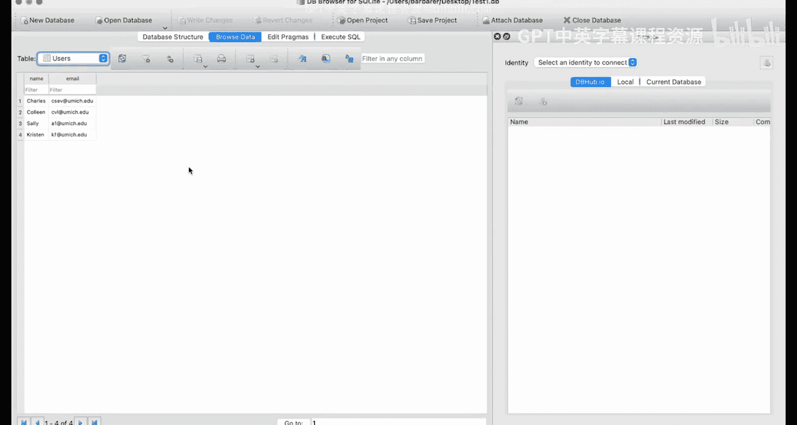
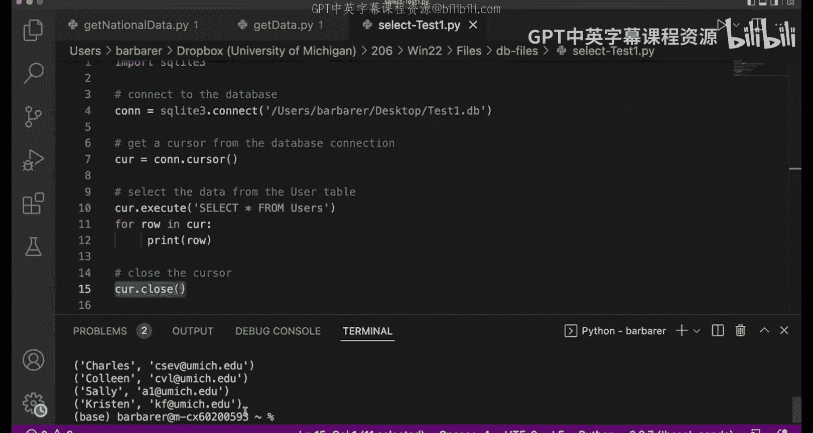

# 密歇根大学《创造性编程（创意、面向对象、debug、QA）｜Creative Coding： Hands-On Python》中英字幕 p175 42_使用Python查询数据.zh_en -BV1ef421S7Bc_p175-

So if you followed along creating a database using these commands from this handout So from the slides that we given you earlier where you created a table users that had two fields or columns name and email that were both text。

 you inserted these users into the table， then you delete it from users where the email was TEed。

 then you updated users set name Charles where email equals this。 then we can try to use Python。

 I'm going to show you how you can use Python to get this data。

 let's first look at it in the Db browser to see what's here。 So here's our tables。

 We have one table users that has name and email they're both text。

 we can browse the data and because we deleted Ted， all the TEs are gone and we change Ch to Charles。

 So here's the data currently in the database and that's one of the nice ways that you can use Db browsers to see what's really going on。

 And then I can show you this also in Python， So here's Python code now to。

Grab the data from the database。 so we first import SQL light3。

 we create a connection to our database。 In this case。

 it's on the same machine in my users's barbara desktop as this file name from the connection。

 I create a cursor。 That's way I can execute SQL so I use the cursor to execute the SQL as a string。

 So select star from users table and then I can loop through。 I can use the cursor as an iterator。

 which will give me a next， next， next so I can use the for each loop for each row for row in cursor get the next row and print it so I can print all the data that I get back from the select and then I can close the cursor to release it。

 and then I see the exact same data that we see in the Db browser so that's an example of how you can use Python to。

Process the data from a database。

