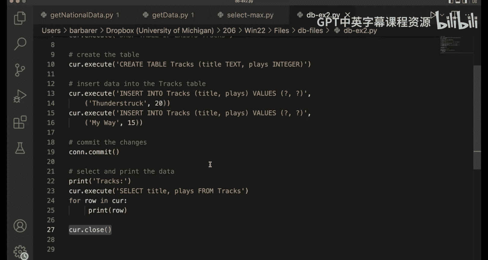

# 密歇根大学《创造性编程（创意、面向对象、debug、QA）｜Creative Coding： Hands-On Python》中英字幕 p176 43_Python实现SQL操作.zh_en -BV1ef421S7Bc_p176-

We can use Python to do many SQL statements， so here's another example Of course we have to import SQL light 3。

 We have to create a connection in this case I'm doing an on my local machine。

 If it doesn't exist it will create this file then we create a cursor from the connection and we use the cursor to execute our SQL so here we're executing a drop table if it exists tracks This is handy when you want to do everything in Python and you want to just start fresh so you can drop a table then I can create the table tracks。

And I specify that it has two fields， it has a title that's a text and a number of plays。

 that's an integer， and then I can insert data into tracks for title come plays and for values notice I'm using these question marks and then I'm separately specifying the values for those by using a tuple this is the recommended way of doing things to prevent SQL injection attacks or when people combine strings to create things。

And then because we've added data， we need to commit it， save this。

 and then we can print out if we want， we can use the select to figure out okay。

 what's there so we're going to select title comma plays from tracks and we can loop through the cursor remember we can treat it as an iterator for row and cursor print row。

 and then we want to close the connection。 We can do that by closing the cursor。

 closing the connection。 So that's how you can work with SQL in Python。

