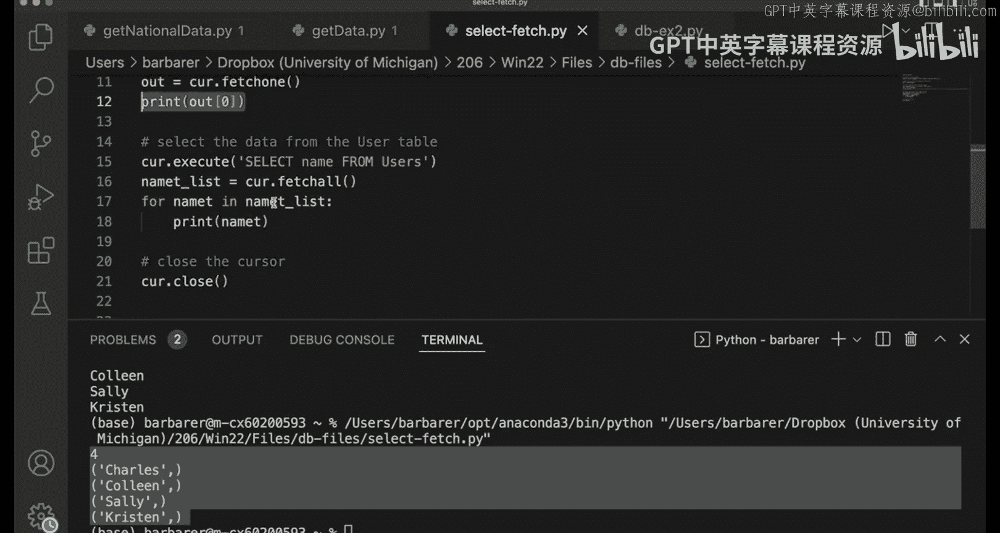

# 密歇根大学《创造性编程（创意、面向对象、debug、QA）｜Creative Coding： Hands-On Python》中英字幕 p177 44_fetchone与fetchall应用.zh_en -BV1ef421S7Bc_p177-

So when you use a select， there's a couple different ways you can process the results。

 We've seen already using an iterator to loop through the cursor。 That's one way。

 But what if you are doing something like this where you're selecting just the count of a field。

 So you're just getting back one value。 Well then you can use this cursor do fetch1。

 So it gets you just the next item as a tuple still。

 So I'm going to put that in out and I'm going to print out。

 and then I can also use something called fetch all。

 So here if I'm saying select all of the names basically from users。

 and that can get that back as a list So I can say list equals cursor do fetch all that gives me back all of the return items as a list。

 and then I can loop through them。 So for name Now remember it's going to be a tuple。

 So name tuple in name tuple list。 and then I'm going to print just the first element of that tuple。

 So let's see how that looks。When I execute it。 So I see this very first piece is this result of printing the count。

 So I printed out the result of the output of that， which is a tuple。

 So I see the four common nothing。 I could have instead just printed the zeroth item to get the actual count。

 So let's try that one more time。 Now I see that I'm getting just the four。

 And because I did that here， I said， give me back the zeroth item of the tuple。

 I'm getting back just the names instead of the tuples with the names。

 If I instead said I'm going to print the name here。Then I would see them as tuples。

 so remember you can just use the results of a cursor as an iterator and you can loop through the results that will be tuples also that you're working with。

 you can instead use fetch1 if you have one particular thing that you're looking at or if you only want to look at one so I can use fetch one and then remember it's a tuple so if I have to access the first element if I want just the one thing or I can get a list。

 an explicit list of all the tuples and then I can loop through those。

