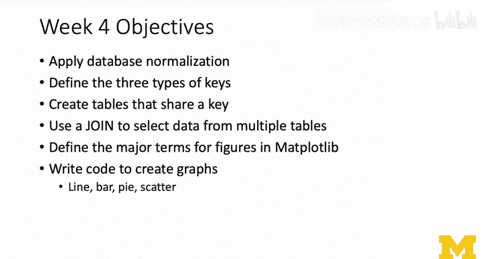
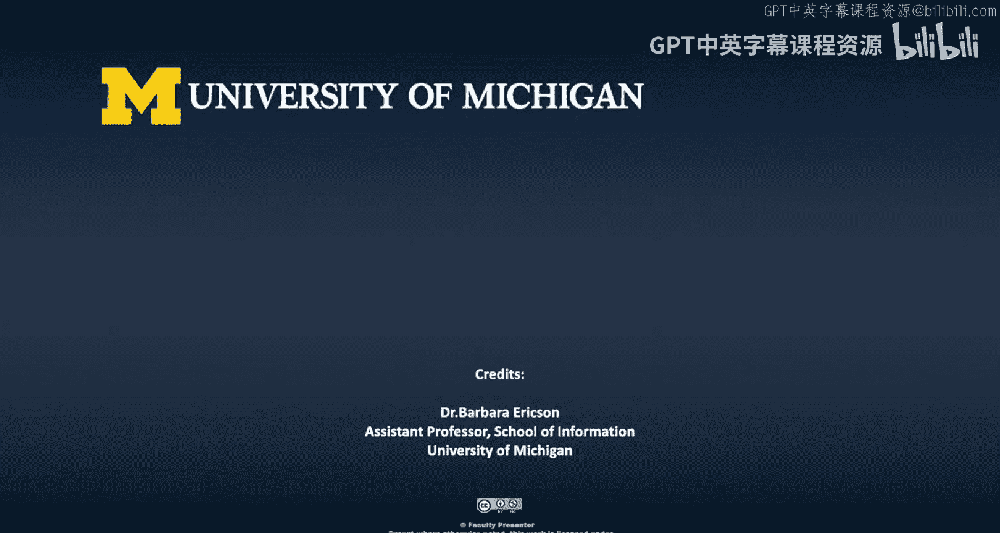

# 密歇根大学《创造性编程（创意、面向对象、debug、QA）｜Creative Coding： Hands-On Python》中英字幕 p178 45_欢迎进入第四周.zh_en -BV1ef421S7Bc_p178-

Welcome to the last week of this course。 What are you going to learn this week。

 You're to learn how to apply database normalization。 And that's the process of breaking。

Things in a database into different entities or classes。

 And then making sure you have no duplicate string data in the database。

 you're going to define the three types of keys。 So foreign keys， logical keys and primary keys。

 you' can be able to create tables that share a key。

 and then use a join to select data back from multiple tables。

 and you'll be able to define the major terms for figures in matpllibb。

 which is software for charting or creating plots。 and you'll write code to create those different kinds of plots or graphs。

 So line bar， scatter， Pi， all of those。 So lots of useful things。 Have a good week。

