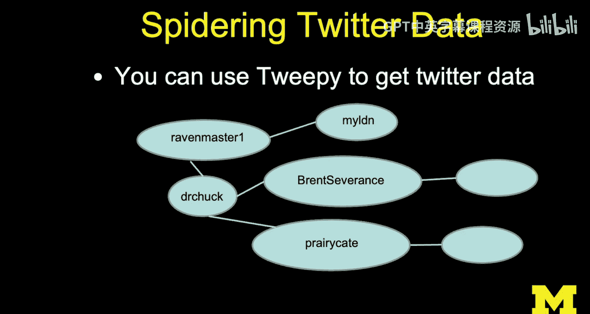

# 密歇根大学《创造性编程（创意、面向对象、debug、QA）｜Creative Coding： Hands-On Python》中英字幕 p179 46_Twitter爬虫入门.zh_en -BV1ef421S7Bc_p179-

So we're going to spider Twitter data with the database。

 and this is going to gather data a little bit at a time from Twitter for a particular user and then find five of that user's friends and then continue that process。

 Okay， for each new user， find five of their friends。

 So you can imagine this could take quite a while。 And there'd be a lot of interconnections there be people that be friends with other people。

 Enjoy reading this chapter， and then we'll talk about it a little bit more detail。

