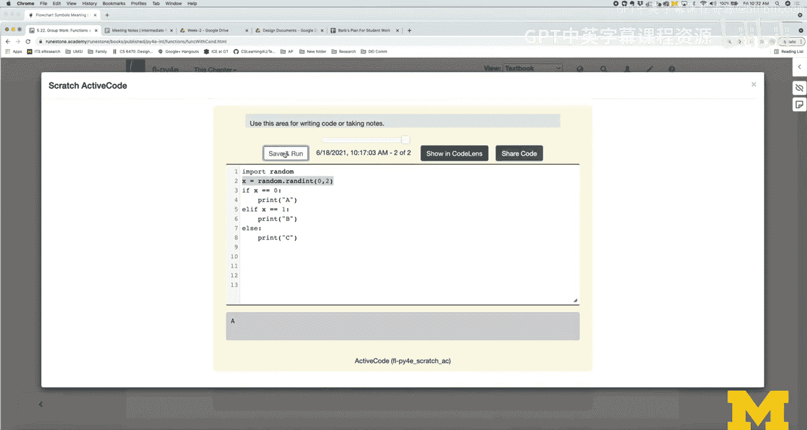
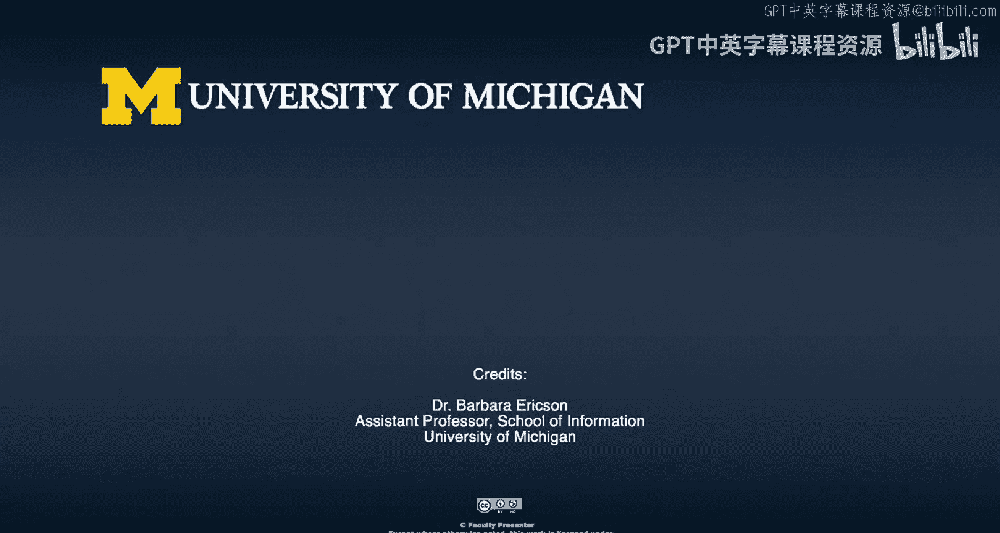

# 密歇根大学《创造性编程（创意、面向对象、debug、QA）｜Creative Coding： Hands-On Python》中英字幕 p18 17_条件语句解析.zh_en -BV1ef421S7Bc_p18-

We've been mostly executing code sequentially， one of the things that gives programming power is the ability to conditionally execute code。

 so only execute code if this condition is true or if it's false。And so for an example。

 what if there are three people and they want to go out to eat and they can't decide on a restaurant。

 they have three different favorite restaurants。 So how would you randomly pick one of those in you could use a dice。

 but there's no threesided dice， you can write a python program to do it。

 you could randomly pick a number between 0 and 2， that's three options 012。

 and then you could say okay， well， we'll go to restaurant A if it's 0 B if it's one and C otherwise or C if it's2。

 So how would you write that in how would you look at that in execution。

 So one of the ways that we look at the way code executes or we diagram the way code executes is called a flow chart。

 And in a flow chart use a diamond shape to represent conditionals。

 So here we're saying if this condition x equals0 is true， then return a otherwise if it's false。

 then execute x the conditional check if x is equal to1， if that's true， return B otherwise return C。

 So let's look at。That in code in Python code。So we'd have to import the random library or module。

 That's what lets us do random number generation or pseudo random number generation because it's not truly random。

 So we say， hey， X set yourself to a random integer between 0 and two inclusive， so 01 or 2。

 and then we check if x is equal to0， print A， otherwise if x is equal to1 print B。

 otherwise print C。 And if we run this， we'll see that the value changes， sometimes it's a。

 sometimes it's B， sometimes it's C。

So conditionals are one way to add more programming power。

