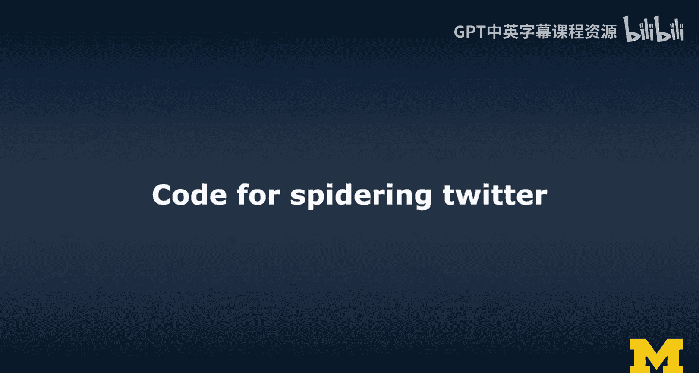
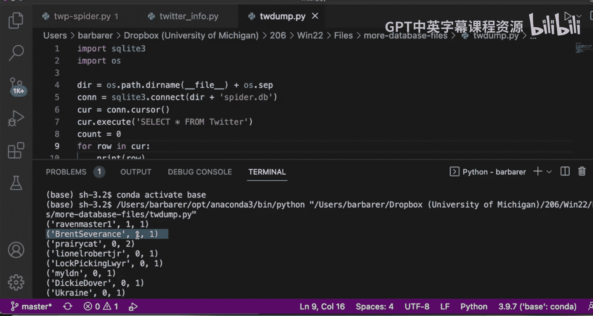

# 密歇根大学《创造性编程（创意、面向对象、debug、QA）｜Creative Coding： Hands-On Python》中英字幕 p180 47_Twitter爬虫代码实现.zh_en -BV1ef421S7Bc_p180-

Before you can spider the Twitter data， you're going to first need to install Twey。

 which is an API for using Twitter， and then you're going to need to get a developer account for Twitter。

 So follow these directions here in the file。 and one of the things it'll give you is a bear token and you just put this into this Twitter underscore Info Py file。

And that's best practices to separate out the authorization， so here we import Twitter infofo。

 underscore Info， that file， and then we can use the information from that file in order to do our authorization to in order to create bat and then use that to create our API object。

So that's best practices， you don't want to hard code it into your file that you're sharing with other people so you separate it out。

And then here we're setting up the database， getting access to the database。

 So we are looking the same directory as where this file is executing。

 creating our connection to that file from that same director as Sp do Db。

 creating the cursor object using the cursor object to execute this create table if not exist。

 And because we're stopping and restarting this code。

 we want to make sure we don't drop the table every time we run it。

 or we would never have any new data added。 So if we're adding data over time。

 we don't want to drop tables。 we want to instead create tables if they don't exist。

 So the very first time we run this， there won't be a table。

 it'll get created the second time it'll exist。 So won't add or change it。Then while it's true here。

 we're asking the user to enter either a Twitter screen name。

 hit enter a type quit if they type quit， then we break if they hit enter。

 so the length of that is less than one， then we just select somebody that we haven't retrieved yet so we're retrieved equals 0 and limit1 and because we use limit one。

 we can do a fetch1 which gives back a tuple so we use brackets 0 to get the first item out。

And then we print we're refreshing friends for the screen name。

 so either the users entered a screen name or we have we're grabbing one that hasn't been visited。

So we go ahead and get a list for friends for that person。

 And then we update this person to make sure that we say that we've retrieved their friends。

 And now we loop through five friends。 So this is where we're setting it to the min of either five the length of that list and looping through that range。

And then we're getting the current I， getting the user for that information for that friend。

 and then the screen name for it。 we're checking to make sure it doesn't already exist in the database。

 If it exists， then we just update the number of times we've seen that person already。

 if it doesn't exist， we're inserting into the database and updating our accounts。

 And then we commit because we've made changes inserting or updating。

 So let's go ahead and run this and see what happens。So it's asking me to enter a username。

 I'm going to use Dr。 Chuck who's the person who first wrote the ebook Python for everyone static version then I've made it interactive。

So we're getting friends for him。 We've got five friends， and I'm just going to quit。

 And then let's take a look at this program。 this program will。Print out the data in that database。

 So let's see what we have in the database right now。 So we've got five friends of Doctor Chuck's。

 and we haven't found。 we haven't visited any of them to get their friends yet。

 That's what the first0 means。 And they all have one friend so far。 So now if we run that again。

And this time we say basically pick somebody who's already there by typing just enter。 So At says。

 okay， I'm going to get five friends for Raven Master 1。

 and then I'm getting five trying to get five friends for this person。

But we were able to get four new accounts， and one was somebody we've already had。

 and then I'm going to Tech quit。And then we're going a look again at what's the data we have now。

So the data we have now， we have those original 5，1，2，3，4，5。

 And then we started getting new people for that were friends of these other people。

 and notice it updated that we did get the friends for Raven master。

 This is set to one announcedun at a 0。 And for Bret severance also set to one。

 and prairie Crt has already been seen twice。 So that was somebody that two people shared。

So that's a little bit of how you can run this。

