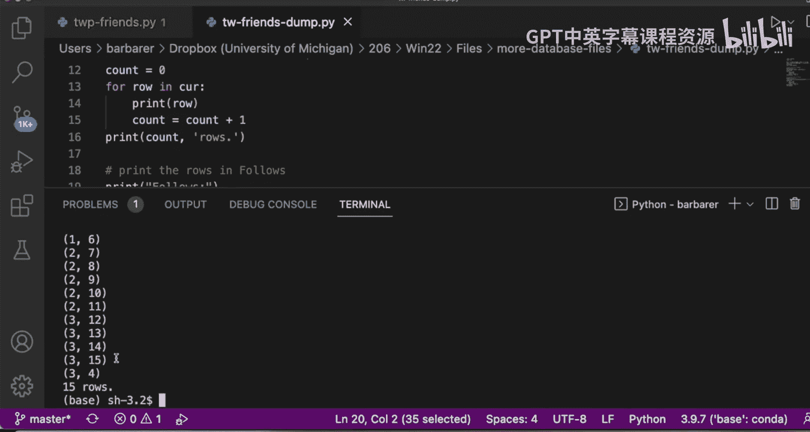

# 密歇根大学《创造性编程（创意、面向对象、debug、QA）｜Creative Coding： Hands-On Python》中英字幕 p181 48_多表操作代码解析.zh_en -BV1ef421S7Bc_p181-

So we've modified our spidering in order to record who's following who。 So we have now two tables。

 people and follows。 So we've separated out who are the people versus who's following who So into these two tables。

 Let's look at this code。 So again， we have some imports。 again。

 we set up the authorization and get the API set up the database stuff。

 So create the connection database， create the cursor。 And again。

 because we want this to run and then stop and run again。

 we're creating the table if it doesn't exist。 So the first time we run it， there is no table。

 it will get created。 second time we run it would still be around。 So we're adding to it。

 very important。 Notice we're also using primary key。

 So we're saying creating an I D for people integer primary key name has to be text and unique。

 and we retrieved as an integer。 And on the second table。

 we're saying that this combination of the from I D who's following who and two I D has to be unique。

SoOne of the things you do when you're starting to create databases is create these constraints about primary keys and what has to be unique in order so that you don't get duplicate data。

 then it's very similar to what we did before， we ask the user either enter a screen name。

 hit enter a type quit if they type quit we stop if they just hit enter。

 we pick somebody who hasn't been visited to get their friends and if so we would select somebody who hasn't been visited。

 retrieved equals0， just get one of those limit1， use fetch1 to get the information we want。

And then we would see if the screen name is in the database already that either somebody entered or we picked。

 and if so， then we're going to get the ID and insert or ignore into people that information。

And then we will try to get the list of friends here。 If we had any problem。

 we'll have this print and stop。 We'll update the person that we got the friends of to say that we have visited their friends。

 We'll loop through again， using the highest of either five or the length of the list。

 And then while we're in range， we're going to get the I， get this username， get the name。

 check to make sure if that person is there。 If we find it， we add one to the count。

Of how many people that we already had， if we didn't find it， insert it。 So now we insert into。

Ignore， insert or， ignore into people， so inserter ignore it will stop us from having duplicate data and won't error so if you try to put duplicate data in。

 if you don't have the or ignore， youd get an error if you try to enter or duplicate data。

 but with the inserter ignore， it says don't add this person if they already exist。

And then if there's any problems， so if row count does not equal one because it should just updated。

 either inserted one account。Then we have a problem。

And then friendend ID is the cursor ID's last row ID so we know what that is and we can increment the count of new。

 and then we can insert into the follows table， the from ID into ID。

And then we can print at the end when we're all done， how many were new accounts。

 how many were revisited， commit the data， and then close the cursor。 So let's try running this。

And just as we've done before， we'll start with Dr。 Chuck。So we get five people from Dr。 Chuck。

 and then we quit， and then we can look at。This。File， run this file。

 which gets the information from people。 but then also the information from follows。

 So we'll see one after the other here。So we have the information from people。

 So Doctor Chuck is number one。 His information has been retrieved。 Doctor Chuck， I mean。

 sorry Raven Master is number 2。 His information has not been retrieved or hers。

 N 3 brought severance。 the information has not been retrieved and so forth。

 And then we know these these people are following Doctor Chuck。

 So number one is Doctor Chuck and number 2 is following。

 number3 is following number 4 is following number5 is following number 6 is following。

 So if we go back and run this again。And this time， we just hit enter saying。

 retrieve somebody else's friends that we haven't retrieved yet。

 So we see now that it retrieves friends for Raven master。And were the accounts for brt severance。

 if we quit。And go back and look at the dump again。Now， we have 15 people listed，15 different people。

 We got five for Doctor Chuck， then we get five for Raven Master 1。

 and then five for Brent Severance。 And you can see those three have all been already accessed their friends。

 whereas the next one be prairie cat。And then so the first five were all following Doctor Chuck。

 and then 7，8，9，10，11， were're all following the second person。

 and then we have people following the fourth， the third person。 And one of these is a repeat。

 So that's a walk through that code。

