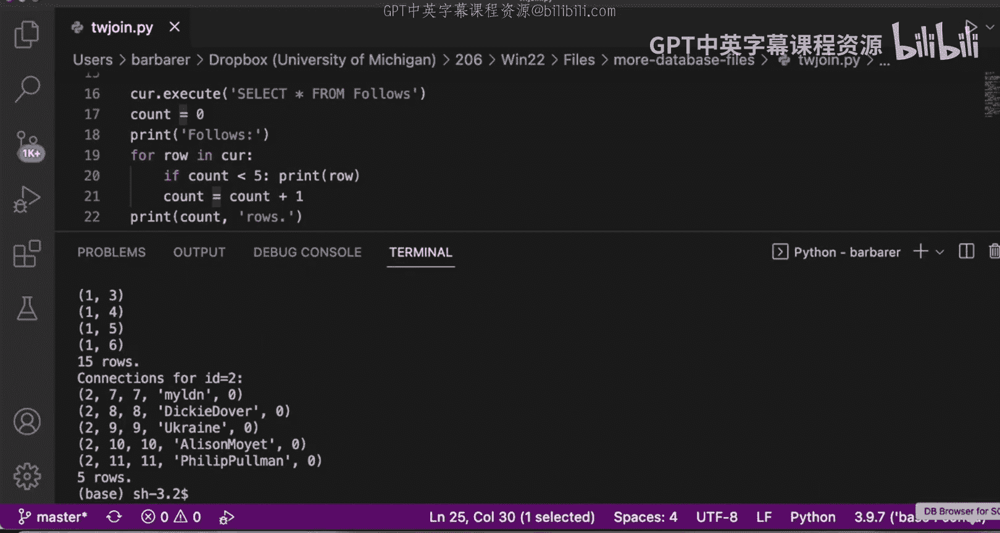
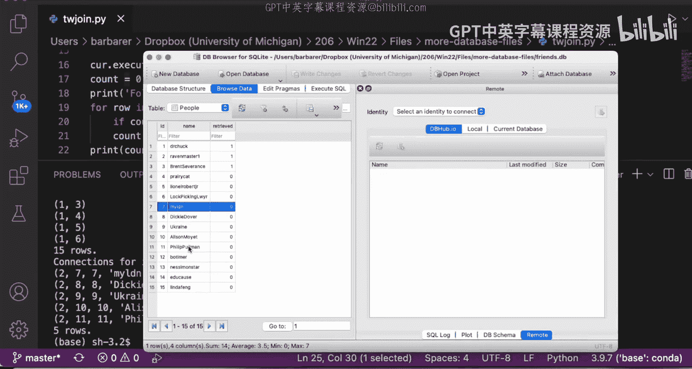

# 密歇根大学《创造性编程（创意、面向对象、debug、QA）｜Creative Coding： Hands-On Python》中英字幕 p182 49_JOIN语句应用.zh_en -BV1ef421S7Bc_p182-

Now that we're using the join， we can get the data from both tables。

 So this is some code that'll show us that。 so we can， of course， import the things that we need。

 We figure out what the directory is for this file， we use that to figure out where the database is。

 So add the directory name to the file name， open up a connection to that database and then get a cursor from the connection so we can execute SQL in the cursor so we can select star from people and we can limit it to just less than five here for doing things。

And then same thing we're going to select star from follows， but then this is the join。

 So select star from follows， join people。 So that's all the columns from follows followed by all the the columns from people。

On follows dot2 ID equals people dot ID。 So notice is just a single equal sign here。

 and then where follows dot from ID equals 2 and count equals 0。

 and we're going to do less than five of those。 So let's run that。And we see we have data now。

 I'm going to show you the data in the D browser， as well。

So here in the Db browser is the follows table。 remember what I said it's going to do is grab all the columns of the follows table followed by the equivalent columns in the people table。

 So here's with the where clause we limited to this where the from ID equals 2 So we see 272829。

 and that's what we see here 27，2829。 And then if we look at the people table we see for。7，8，9。

 So these people here。 This is what we've grabbed。 So we've grabbed each of these information here。

 So we've created a temporary table that combines what we've asked for。

 So recombines the data into a temporary place that we can now process it。

 And so that's why join is so powerful because databases are normalized and they're broken into multiple tables but you can use join to bring that data temporarily back together so that you can process it and report on it。

