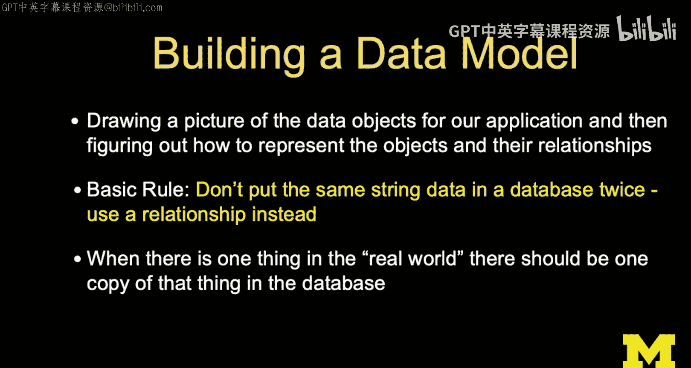
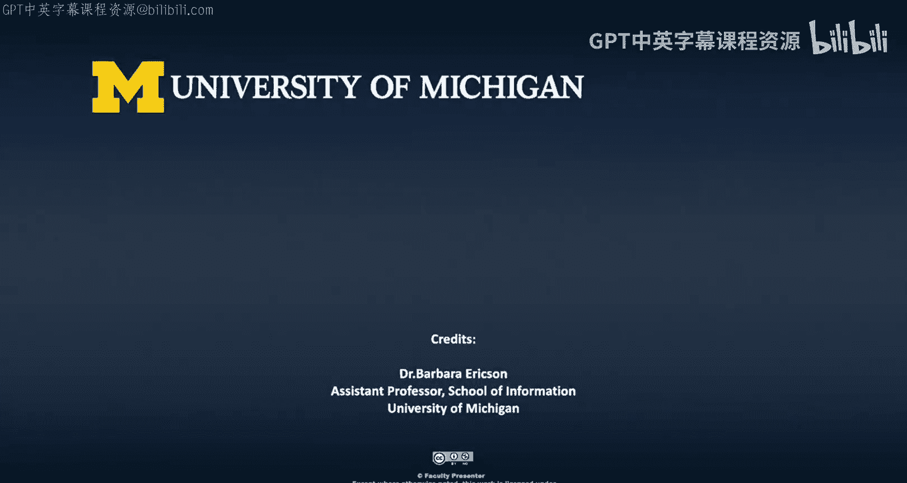

# 密歇根大学《创造性编程（创意、面向对象、debug、QA）｜Creative Coding： Hands-On Python》中英字幕 p183 50_数据库设计目标.zh_en -BV1ef421S7Bc_p183-

So let's talk a little bit about database design， and it's a bit of an art form with lots of people that have lots of skills and experience。

 and our goal is just to avoid the really bad things。

 really bad mistakes and design something that's clean and easily understandable。

 Others may performance tune that later。So one of the things you'll do is try to figure out when you're modeling a domain。

 what is the data that you need to store in the database and you'll draw a picture of the entities that you're talking about are the classes you can think of them as and the relationships between them and one of the rules is don't put string data in the database twice。

 so don't duplicate any string data instead use a relationship so have primary keys that are typically numbers and that have that string data and then use a reference to the string data by that ID。

And if theres one real thing in one thing in the real world。

 then it should be one copy of that thing in the database。

 and that's partially because if you have to modify a database。

 you don't want to have to change it all over the place。

 it also makes it easier to grab or find data if there's just one copy of something in the database。

