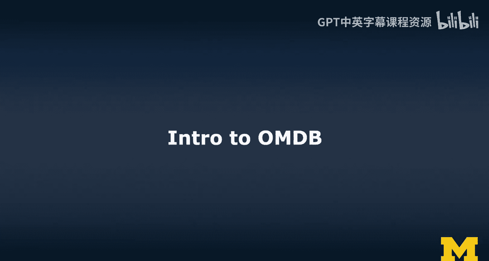
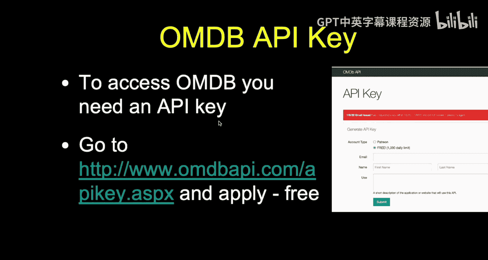
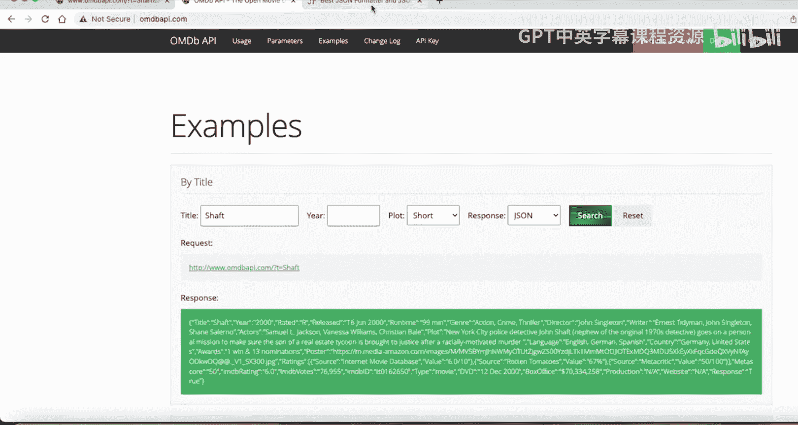
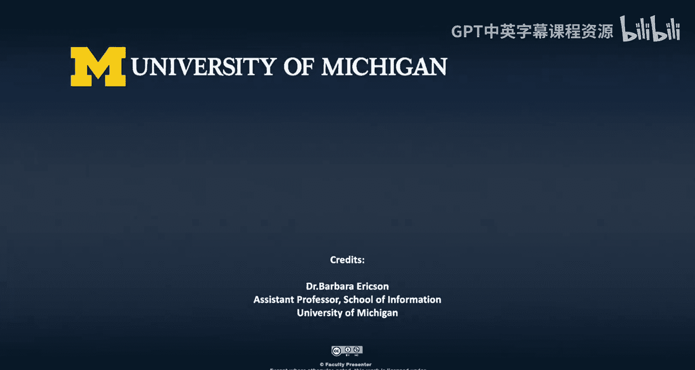

# 密歇根大学《创造性编程（创意、面向对象、debug、QA）｜Creative Coding： Hands-On Python》中英字幕 p184 51_OMDB接口解析.zh_en -BV1ef421S7Bc_p184-

To work with OMDB， one of the things you're going to need is a key。

 and you can get that key from here， Ww OM ODb do com API key so we can see that。

Here。If you go to API key here at OMDB and you want it' do the freeze。

 then you'd enter your email address， your first name， last name， why you want to use it。

 you can say you're using it for an online course and then hit submitit and you'll get an API key。

And then if you go back to see how you use this， so youd just go to this URL and after the question mark。

 you'd put the API key equal and then your digits for your API key。

And then these are the parameters that you can use， for example。

 if you want to look for a particular movie title， you can use the parameter T for title and specify the movie you want to search for and here are some examples。

 So if I want to look for a movie like say shaft I can just search for that there now I have that information and I can grab that information and put it in a formatter to make it easier to understand and so I can see what I get back as a directory and it has keys of title shaft year 2000 rated R I might want the actors notice there's a list of actors that for actors I get a string that has several actors in it I can also get the ratings which is a list of ratings and each side of each of that is a dictionary so I have internet movie database and its value on tomatoes and its value so this is the kind of data that you can get with JSON is I can get back that and I can use one of these formatmatters like the JSson formatmattter。

org to see it and understand how to grab the。

I want。

