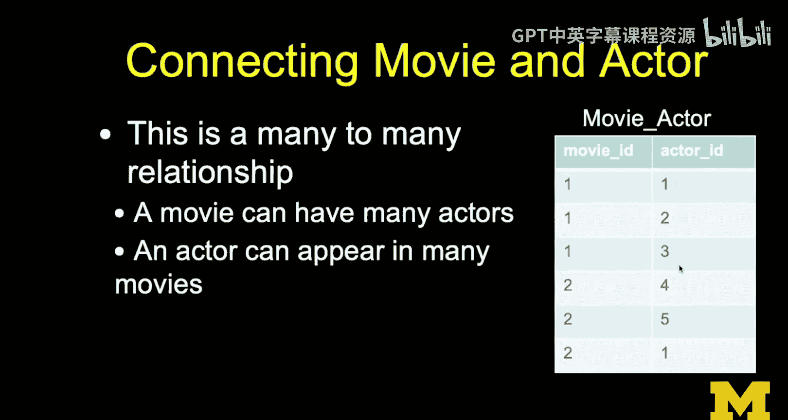
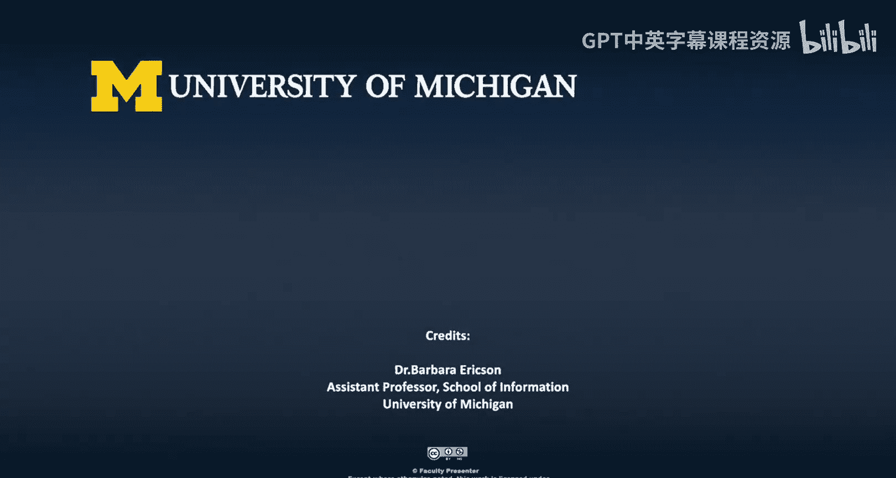

# 密歇根大学《创造性编程（创意、面向对象、debug、QA）｜Creative Coding： Hands-On Python》中英字幕 p185 52_OMDB数据表设计.zh_en -BV1ef421S7Bc_p185-

So if we were processing data from OMDB and we were trying to figure out how to put this in a table。

 one of the things that people start with is just one table。

 So if we wanted to keep the title and the year of the movie and the actors in a movie。

 you might start with something like this。 Ti is a string year could be a number or string Actctors。

 You might have a string that's a list of actors separated by commas。

But notice that this would violate one of the principles of database normalization is that we don't want duplicate strings in a database。

 So we have Samuel L。 Jackson twice in here， and we don't want that。

 And we really are talking about different entities here。 So when you're looking at this data。

 One of the things you want to do is say， what data， what kind of thing or entity。

 does the data belong to。 So title and year both belong to movie。 But actor is another kind of thing。

 It's another person。 It's a different entity。 And so we'd want to separate that out。

 You want to have a movie table and actor table so that we don't have duplicate string data。

 So we want to pull that apart。 So we would have movie data and actor data。

 and we would assign a primary key to each one of them because you might have actors with the same name。

 So you want to show that they're unique， you might have movies with the same name。

 but different year。 So we might say that the title in the year have to be unique。

So you want to break things up。 But now how do I connect movie and actor。

 So I have movie table and a actor table and they represent these separate entities。

 But together we have a movie can have many actors and an actor can be in many movies。

 And that's called a many to many relationship。 And when we have that we create another table that just uses the Is。

 So movie_ D from the movie table and actor underscore D from the actor table。

 And so for a movie who are all the actors in it。 And so for each movie， we can do this。

 And so that way， we've normalized the data。 We don't have duplicate data。 We're using primary keys。

 which are numbers to represent objects。 And then we can use joins to bring that all back together。😊。

