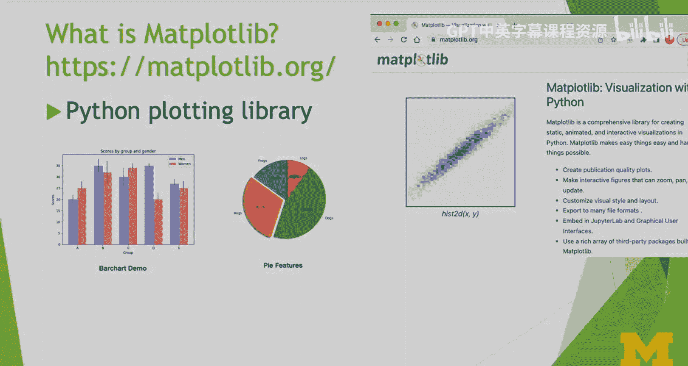
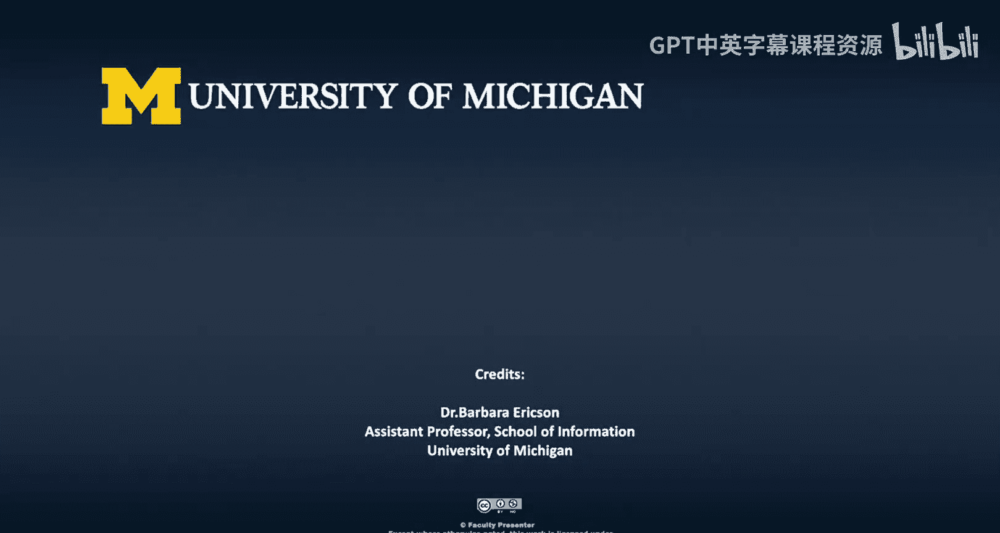

# 密歇根大学《创造性编程（创意、面向对象、debug、QA）｜Creative Coding： Hands-On Python》中英字幕 p187 54_Matplotlib基础.zh_en -BV1ef421S7Bc_p187-

What is mat plotlib。 Well， this is a Python plotting library that can be used to create lots of common plots。

 and it's pretty easy to use to make simple things。 So things like bar charts or pie charts。

 Sc plots， line plots。 Those are all pretty easy to create。

 So we're going to show you how to use these。

