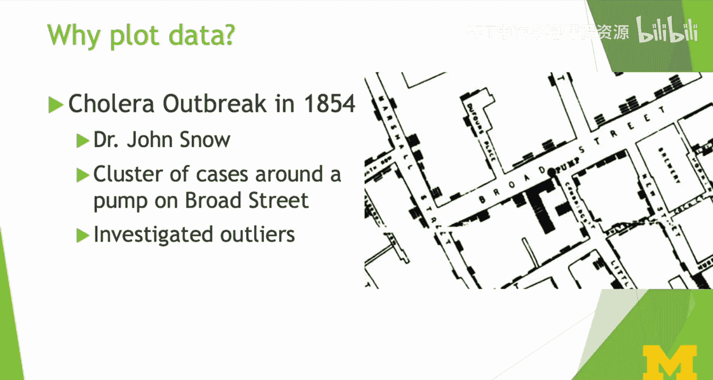

# 密歇根大学《创造性编程（创意、面向对象、debug、QA）｜Creative Coding： Hands-On Python》中英字幕 p188 55_数据可视化意义.zh_en -BV1ef421S7Bc_p188-

So why do we plot data， Well， we plot data to understand relationships and things that are particularly that are hard to see otherwise。

 So if you have just two points of data， you don't need to plot it。

 But if you have lots of data it can be very handy。 For example。

 there was a cholera outbreak in London in 1854。 and a doctor， Dr John Snow。

 started creating this map of the cases， So each each case was a little line here。

 And you can see that there was this sort of suspicious clustering of cases around this pump。

 where water people were getting water from。 And he also found some outliers。

 and he investigated the outliers。 So there were people that were not in this area that were also getting cholera。

 and he found that they liked the water from here and got the water delivered to them。

 even though they weren't living there。 And that there were other people that lived in this area that didn't get cholera。

 and they tended to work at places where they had their own water source。

 So they weren't using this pump。 And so this data helped figure out that cholera was spread by infected water。

