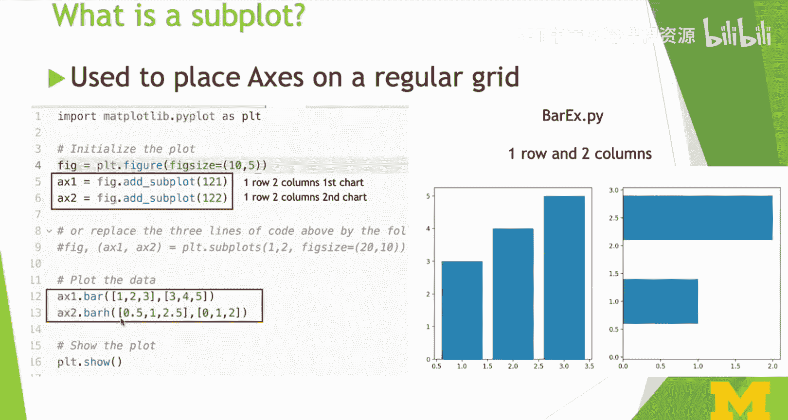
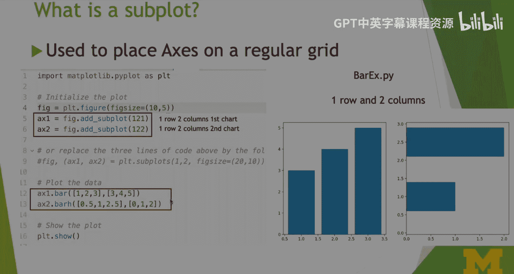

# 密歇根大学《创造性编程（创意、面向对象、debug、QA）｜Creative Coding： Hands-On Python》中英字幕 p189 56_核心术语解析.zh_en -BV1ef421S7Bc_p189-

Al right， some of the key terms you need to know for Mattpotlibb is the idea of a figure。

 which is a place that you can have one or more axes or plots。

 So figures or the windows or areas that you're drawing on， they can have a title。

 and then you have on a figure， you can have plots。 and you can have multiple plots。

 So these are areas where points can be specified by coordinates。 you'll have an axes。

 So you might look at this URL which shows the anatomy of a figure。

 And in a figure you can have the X axis， the Y axis。

 you can have a y label for that axis and X label for that axis。

 you can have major ticks and minor ticks。 So a lot of different things。

 you can have a title for your figure。You can have a legend。

 which is explaining what the colors mean here， blue and orange， you can have a line plot。

 you can have markers， which are these little。Items that show particular point on a plot so they can be different shapes。

 so lots of vocabulary to think about when you're working with plots。

And then you can also have subplots。 So you could have a plot。 you could have subplots。

 And when you do subplots， there's an interesting convention here that you use。

 So you say figure dot a underscore subplot 1，2，1。 That means one row， two columns， the first chart。

 So one row。2 columns。 And this is the first chart。 So that's this one。 And then add another subplot。

1 row， two columns is the second chart。 So we have for axes 1， which was the first one。

 We have a vertical bar。 and then for horizontal for the second one for axes 2。

 we have a horizontal bar chart。 And you can see how easy it is to create just this data。

 So all we have to do is have some data。 And we can say make a bar chart or a horizontal bar chart。

 So pretty simple to get started。

