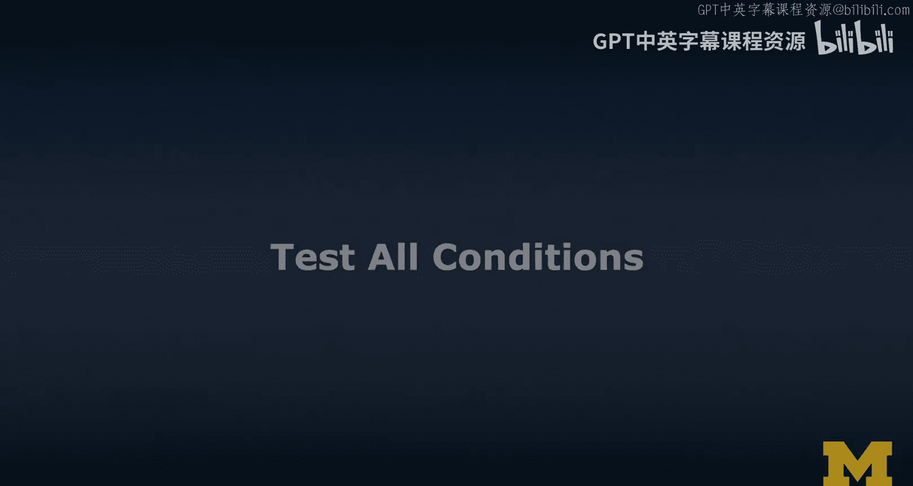
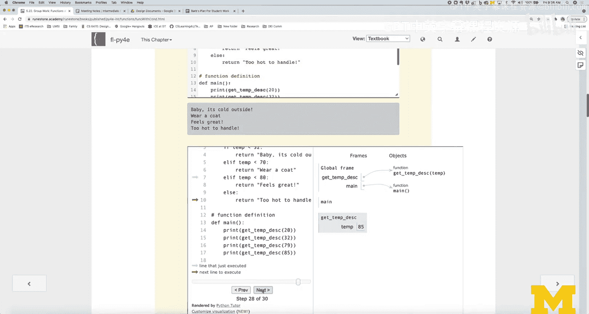

# 密歇根大学《创造性编程（创意、面向对象、debug、QA）｜Creative Coding： Hands-On Python》中英字幕 p19 18_全条件测试实践.zh_en -BV1ef421S7Bc_p19-

With conditionals， it's important when you're testing that you test every branch of the conditional。

 So each possible outcome。 So let's take a look at an example。

 So here we see if we run this code that we have two calls to this function。

 one with 20 and one with 85。 And we're getting two of the possible responses。 So baby。

 it's cold outside and too hot to handle。 So how would we get the other two。

 So let's go ahead and copy this line， line 14。And then modify the numbers。

 So what number should we put in here to get the second response。 Well， so if temp was less than 32。

 it's going to print maybe it's cold outside。 And that's what happens when we give it 20。

 So what happens when we actually give it 32， that shouldn't go to the next response。

 which is wear a coat。 So let's try that。 So it's good to test the boundary conditions or the edges of things。

And let's add another。Line similar to the last one。 And how do we get to this one， wear a coat。

 So it's got to be greater than 32， but less than 70。

 So let's try 69 as the boundary of what's right below 70。So now if I run that code。Oh。

 I made a mistake。So what happened here less than 70 was wearer coatat。 so I wanted less than 80。

 So it should have been 79。 So it's important to check your code when you're running it。

 Now I see that I'm getting each of the responses。 baby it's cold outside。 We a coatat feels great。

 too hot to handle。 So it's important to check every branch of a conditional。

 You can also use the code lens to walk through what's happening in each one of these。

 So the code lens， of course， first thing it's going to do is define that function。

 So we see the function defined， define the main。And then it's going to call the main method。

 So we see we get to the main method。 First thing inside there is it's going to print the result of calling it with 20。

 so we'll invoke that function with a value of 20。And then we'll see when we say next。

 that we'll test this conditional if temp is less than 32。Since it is， it's going to return baby。

 It's cold outside。 We see that as the return value， and then it'll print that result。

 So we'll see that in the print statement。Here， baby it's cold outside， so if we try again with 32。

Come in now。 temp is 32。 We'll check that conditional。 That'll be false。

 So we'll check the next conditional if temp is less than 70， which 32 is less than 70。

 So it'll execute。 return wear a coat。 We see that return value here。

 and then we'll see that it gets printed。Same thing with 79。 We're going to call it with 79。 Now。

 we're going check that first。 If that'll be false， we'll check that elsesif temp less than 70。

 That'll be false。 We'll check elses if temp is less than 80。 That'll be true。 Therefore。

 itll return feels great。 We'll see that returned。 and then we'll see that。 It's printed。

And then the last one we'll see it'll go through each of the conditionals。

 So we check the if that's false。 We check the LF temp less than 70。 That's false。

 Check the LF temp is less than 80。 That's false。 And so we get to the final else and return too hot to handle。

 and we print that。 So remember to use the code lines to see exactly what's happening when you're executing your code。

