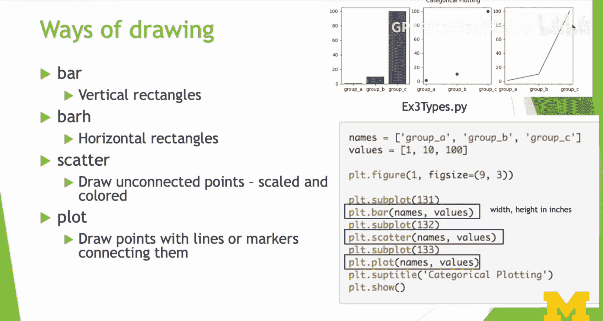

# 密歇根大学《创造性编程（创意、面向对象、debug、QA）｜Creative Coding： Hands-On Python》中英字幕 p190 57_绘图实例展示.zh_en -BV1ef421S7Bc_p190-

So here's a very simple example that shows how easy it is to create different kinds of plots so you can have a list of names。

 so group A， group B， group C， you can have a list of values， 110100， you can say create a figure。

 plot do figure， figure size9 by three， so。Horizontal。Figure， and then we can create a subplot。

 So at 1，3，1。 So this is gonna be one row，3 columns。 This is the first one。

 create a bar from names and values。 and then create a new subplot 1，3，2。

 Use that to create a scatter plot with names and values， and then 1，3，3。 Use that to do a plot。

 which is a line plot。 And then you can add a title and show it。 So this is what you'll see。

 categororical plotting is the title。 These are the three different subplots。 This is 1，3，1，1，3，2，1。

3，3。 there's the bar， there's the scatter， there's the line。 So the bar is just vertical rectangles。

 I could do bar h for horizontal。 I can do scatter as unconnected points， and then plot。

 if I want connected points。 So with lines or markers。s a very simple way to create some plots。

