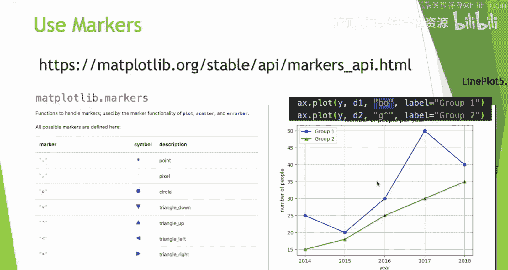
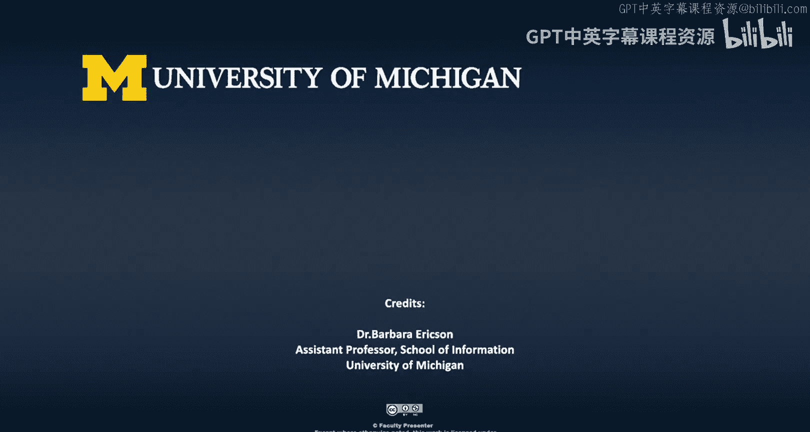

# 密歇根大学《创造性编程（创意、面向对象、debug、QA）｜Creative Coding： Hands-On Python》中英字幕 p191 58_图表增强技巧.zh_en -BV1ef421S7Bc_p191-

All right， some additional things you can add are a legend。 So if you have more than one line。

 perhaps in a line plot or just a plot here， so you have y data for year data and then you have different lines for D1 D2。

 so different values So you can say axis dot plot Y and then D1 and then give it a label and here group 1 and that's what shows up in the legend。

 So legend is a little thing here。And then another plot with Y and D2 data and give it a different label。

 And then when you say Axt legends， it will add this legend。

 What if you want to control the colors of the lines， Well， then you can use this symbol language。

 which is just like B dashash means a blue line。 G dashash is a green line。

Or you could even add markers too。 and if you go to this URL。

 you can see the list of all the kinds of markers。 So here B O is O is a circle marker。

 So you can see that's using a circle marker where G Carrot is using the triangle up。

 So you can also use these different markers to make it more clear where the actual points are。

 So those are some enhancements you can add。

