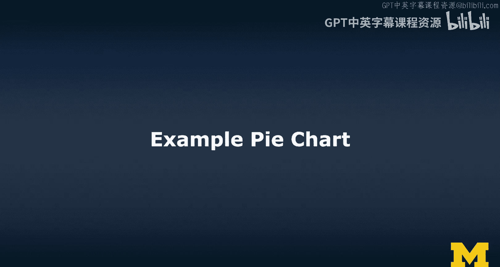
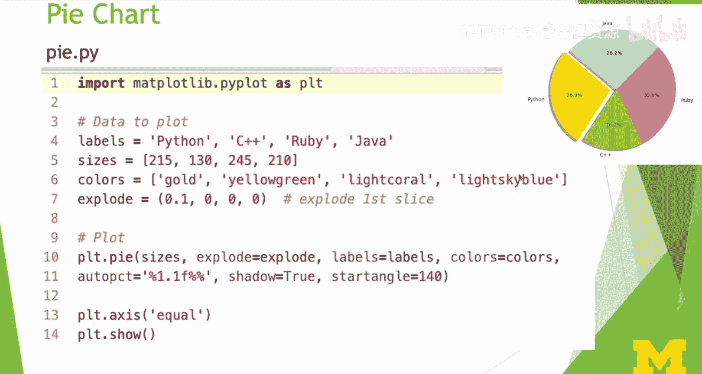
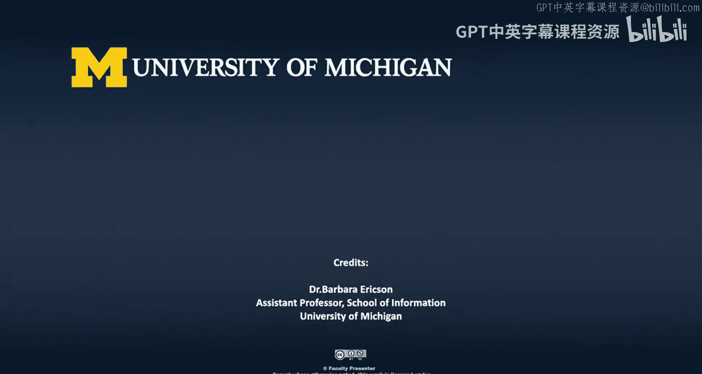

# 密歇根大学《创造性编程（创意、面向对象、debug、QA）｜Creative Coding： Hands-On Python》中英字幕 p192 59_饼图绘制实例.zh_en -BV1ef421S7Bc_p192-

Here's an example of creating a pie chart， so you import Matpoplib as usual。

 you have the data to plot， so the labels， I've got Python， C plus plus Ruby Java，'ve got values。

 notice I can just give numbers here， and then have colors which are string literals for the colors。

 and then I can say how much to explode which slice so I'm exploding the Python slice as you can see that。

And then I can set up the pie charts， so plot dot pi， notice this percent， even I can say。

 how do I want to format it， so I want to add as a percent， notice it calculates it for me。

 which is kind of nice。 whether I want a shadow on it， which is true here。

 And then I say I want to plot the axises equal and show the axes。I didn show the plot。

 so that's a very simple pie chart。

