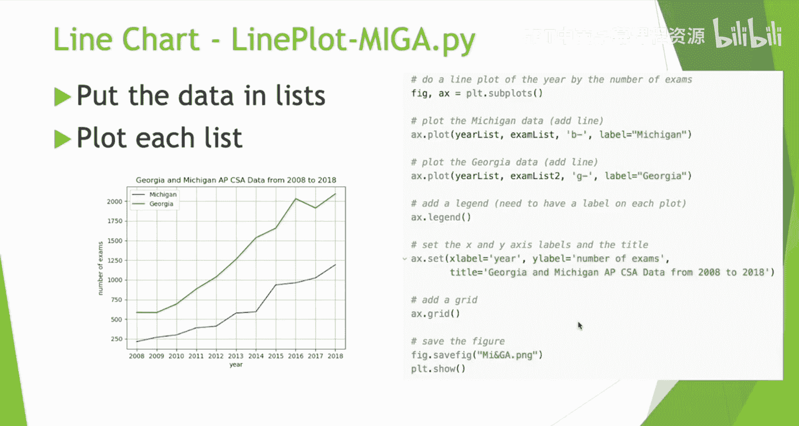
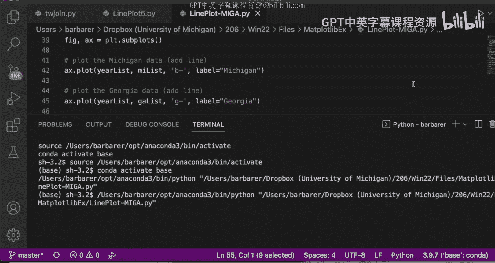

# 密歇根大学《创造性编程（创意、面向对象、debug、QA）｜Creative Coding： Hands-On Python》中英字幕 p193 60_密歇根与佐治亚数据可视化.zh_en -BV1ef421S7Bc_p193-

One of the things I've known for is working with the advanced Place computer science data。

 and I typically write a program to analyze the data in multiple spreadsheets and put it into one spreadsheet and then plot the data。

And so one of the things you might have here is I have some sample file with JSON data。

 so it's for each state for each year how many people took the exam。

 what was the population of the state test per population so there's several pieces of data here and then what you can do is read the data from the JSON and put the data into lists and plot the different states so for example I often I was working in Georgia for a long time and I'm from Michigan originally and now I'm in Michigan again。

 so I wanted to see how did the AP computer science A exam data change in a certain time period。

So I do create a plot and get the data for Michigan all into a list and then get all the data for Georgia all in a list and then。

Create two different line plots for those， add a legend for them that serves Michigan and Georgia。

Set the labels to be the years that I'm talking about the data。

 the number of exams for the Y labels and then add a grid。

 of course you can see the points easier you can also save a figure which is kind of handy if you did turn in a figure or you want to print it include in report or something so I can give it a dot PNG which is a format that you can use for images and show it so let's look at that in visual studio code。

So in visualual Studio code， of course， there's beginning pieces here where I'm importing things。

 and then I'm trying to read from the file and get the data into a dictionary。

And then when I have it in the dictionary， then I get the data from Michigan。

 so loop through the data in the dictionary for Michigan and get that into a list and then do the same thing with the data from Georgia and put that in a list。

And then that then the data that the things that you've already seen。

 so create the figure and the axes， plot the Michigan data using a blue line。

 plot the Georgia data using a green line， add a legend， set the axis labels and the title。

Add a grid， say the figure and show it， so let's just see what happens when we run that。

And so there's the data。

