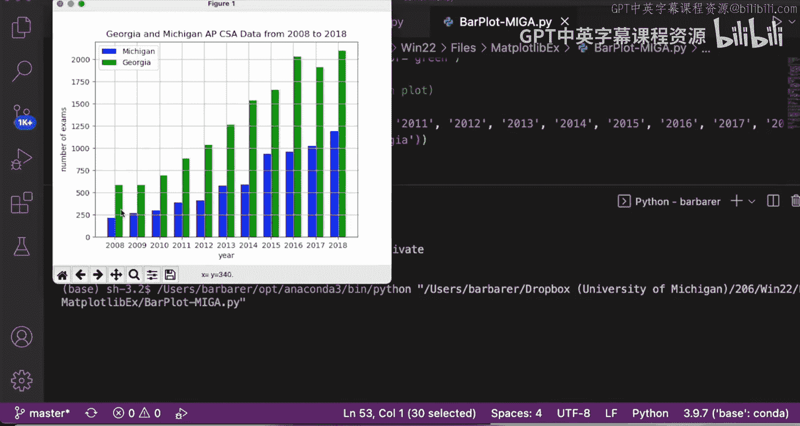

# 密歇根大学《创造性编程（创意、面向对象、debug、QA）｜Creative Coding： Hands-On Python》中英字幕 p194 61_并列条形图绘制.zh_en -BV1ef421S7Bc_p194-

If you have data from multiple states， you might want to have a couple of bar charts right next to each other。

 bars right next to each other。 So here's an example of this for the AP data。

 If I wanted to have the blue Michigan data right next to the green Georgia data to make it easier to compare the two for a particular year。

 I have to do a little bit more work。 So let's look at the code for this。

So as usual I have to import all the libraries I'm using that I'm going to try to get the data from the dictionary。

 so it's a JSON， read it from a JSON， it's a dictionary。

 and then get the grab the data from Michigan， put it in a list and grab the data from Georgia。

 put it in a list。So do those things。 Then I can do the usual net plot lab things of creating the figure in axes。

 This is the part that I have to do in addition。 I have to tell it how many pieces of data I have on the one axes。

 So I'm telling it it's 11 I could also have gotten the length of something and then how wide do I want the bars ingen bars and then I use NP I have to import。

Numpie as MP。 And then I can use numpy to figure out how to spread that across evenly across the 11 things。

 So that's what I'm using there。 I these indices， equal N dot arrange these n items。

 And then when I plot， notice that my bar， I say the indices here。 And then the Michigan list。

 the width， the color。 And then when I do。The second bar。

 I say indices plus width because it has to go next to that。

 and then the Georgia data and again the width and the color。

 And then when I set the axis labels for the axis， I have to say index plus width divided by2。

So a little bit more work to make this look good。 but when you finish it up， it looks very nice。

So I can see that the blue labels， the blue bars are before the little tick mark so that it's right in the middle of these two。

 and they are each of the same width。

