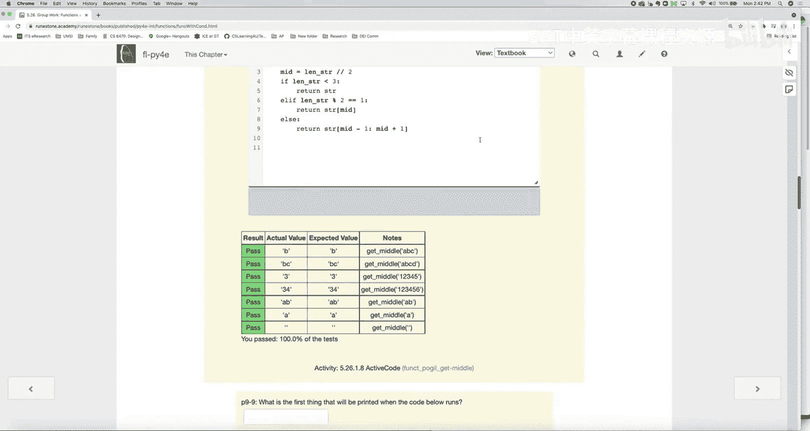
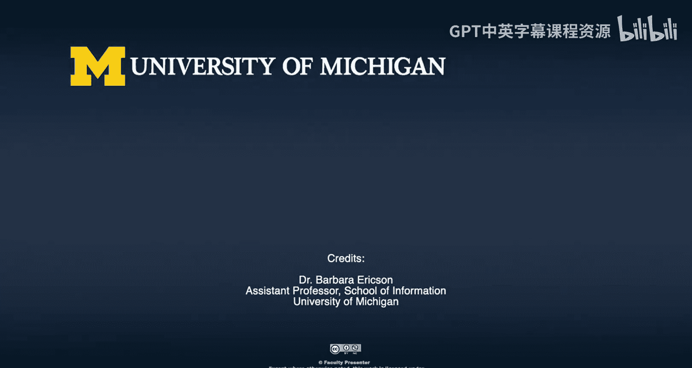

# 密歇根大学《创造性编程（创意、面向对象、debug、QA）｜Creative Coding： Hands-On Python》中英字幕 p20 19_编写get_middle函数.zh_en -BV1ef421S7Bc_p20-

I hope you enjoyed working on those exercises。 Let's go over one of them。 Git middle。

 So what Gitmi wants you to do is return the middle characters from the past string SR。

 We want to say if the string has less than three characters。 So we're going need to get the length。

 return the past string。 If it has an odd length。 Again， we need the length。

 return the middle character。 If it's an even length， return the two middle characters。 So。

 for example， Git middle of ABC is going to return B， which is at index 1。 So 0，1，2。

 and git middle ABC D is going to return two characters， the want to index 1 and the one index 2。😊。

So we're going to need the length， so let's go ahead and create a。Variable。

 I'm going to call it langstern equals length of STR， so using that built in line function。

So now we have the length of string we can check now we can either I'm going to go ahead and get the middle of it too。

 so mid is length string divided by two， but if I just divide by two with one slash。

 that's floating point division， I need the double slash to get integer because I can't take。

The item of a string at index 1。5， I can only use integers。

So now I'm going to use my conditionals so if the length of the string or fl string is less than three。

 then I'm just going to return the string。Otherwise， or e， the length of the string。 And if it's odd。

 how can I check if it's odd。 So if I use the remainder operator where I say。

 what's the remainder when I divide by 2？ And if that remainder is equal to 1， then I know it's odd。

 So then I can return string just getting the index of that single character at mid。

 becauseuse remember， if I had three items，01， dividing 3 by 2 gives me 1。5。

 throwing where the fractional part gives me the  one。 So that should work great。Otherwise or else。

I'm going to return the string and I want two characters。

 so if I have four characters and I have length of four， dividing by two would give me2， so0，1，2。

 but I want the one that starts before that。 so I'm going to say string starting at mid-1。

And then I want to end， remember the way that slicing works is you specify one more than where you actually want to include。

 so I'm going to say all the way up to mid plus one。And try that。

And I see that that passes all my test cases， so that's one of the ways that you can solve get middle。

