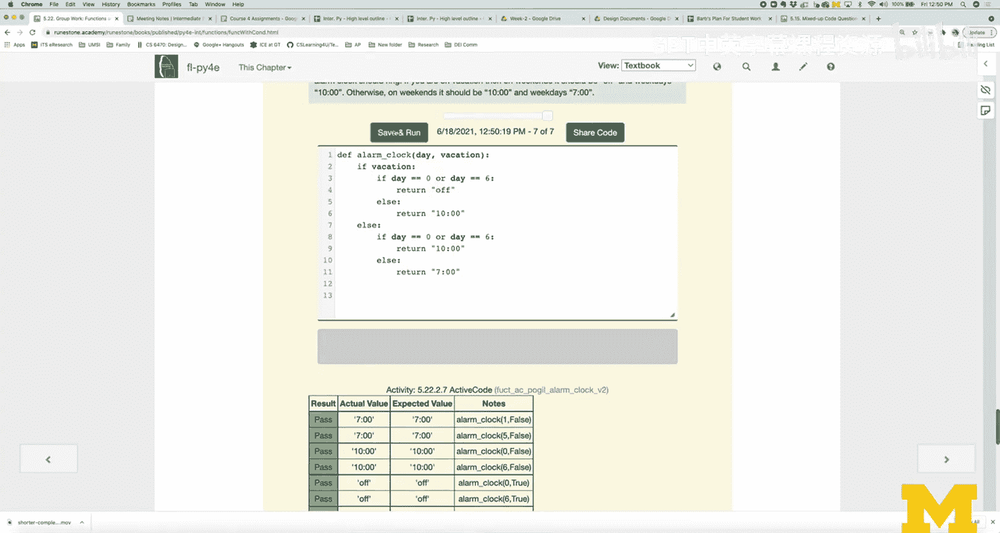

# 密歇根大学《创造性编程（创意、面向对象、debug、QA）｜Creative Coding： Hands-On Python》中英字幕 p21 20_实现闹钟功能代码.zh_en -BV1ef421S7Bc_p21-

So let's take a look at the alarm clock function and a couple of ways you can solve it so as it says。

 you're going to be given a day of the week andd using a number and a boolean whether or not you're on vacation and then what you want to return is if you're on vacation on a weekend it should be off。

Weekdays，1010 o'clock， and a week end is defined as Saturday or Sunday。 So that would be 0 or 6。

 And then otherwise， if you're not on vacation， if it's a weekend， it should be 10。

 and if it's a weekday 7。 So let's go ahead and code that。

So one of the ways we can check if it's a weekend， so I'm going to go ahead and make a list。

With just 0 and 6 in it。 so we can use the in operator in Python to say a something in a list。

 So that way， we can check if it's a weekend that way。 And since we've been passed in vacation。

 we can immediately check if it's a vacation。 So if it's vacation。

 you can just check that if vacation， that'll be true or false。And if it's a weekend。

 so if the day is in weekend。So we know it's a weekend。

 then we're going to return off because you're going to sleep in。Otherwise， we're going to return 10。

And then if it's not， so else， if it's not a vacation， then if the it's a weekend。

 if day is in weekend。We can return。10 again。And otherwise， we're returning seven。So we can run that。

 check that。And so that's passing all the tests， so that's correct。Of course。

 there's lots of other ways you can solve this。 So instead of having this list of weekend days and checking that if that day is in the weekend。

 we could just say explicitly if day is equal to 6，0 or day is equal to 6。

 so thatd be Saturday or Sunday。So we could do that instead。So if we run that。

 we see again that oops bad error online line 3， What did I do wrong here， Oh forgot my colon。

 easy to do。On both of those。

So if I check that and we've passed all the tests again。

 so that's at least two different ways that you can solve the alarm cut problem。

