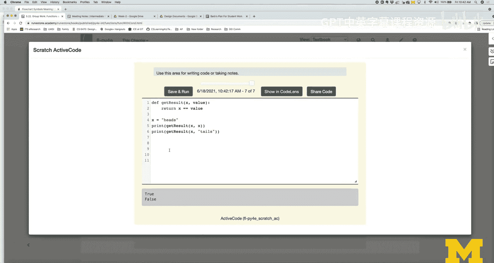

# 密歇根大学《创造性编程（创意、面向对象、debug、QA）｜Creative Coding： Hands-On Python》中英字幕 p22 21_布尔表达式返回值技巧.zh_en -BV1ef421S7Bc_p22-

You often have a conditional with just two values。 So， for example， if you flip a coin。

 it's either heads or tails。 So you could have a function that checks。 hey。

 does this variable equal this value。 And if that's true， you can return true。

 And otherwise you can return false。 Let's take a look at that in code。 So in code here。

 we have a function get result that takes a variable X and a value and it checks to see if x equals that value。

 If so returns true。 Otherwise it returns false。 So if we set X。 Now notice this is a different。

 I can reuse x here， This is a different x。 So the names are local in Python。

 The name for this function， this x is a different name space， then out here。

 as we can reuse that variable name。 So x equals heads。

 we print get result passing in x and the value X。 which should give us a true。

 and then try get results with x and the value tails。 If we run that。

 we see that we get true first and then false。 There's an easier way of writing this or a shorter way of writing this。

 So we're checking if this。It' true， and if so returning true and otherwise we're returning false。

 we could just return that test， the value of that test。

And then we can get rid of these three lines of codes if we do that oops。I have this。Colon there。

 There we go。 If we do that， we get the same result。

 So if you're ever finding yourself saying if something is true， return true， Otherwise。

 if it's false， return false， you can just say return that test。

 So that's one way to make your code shorter。

