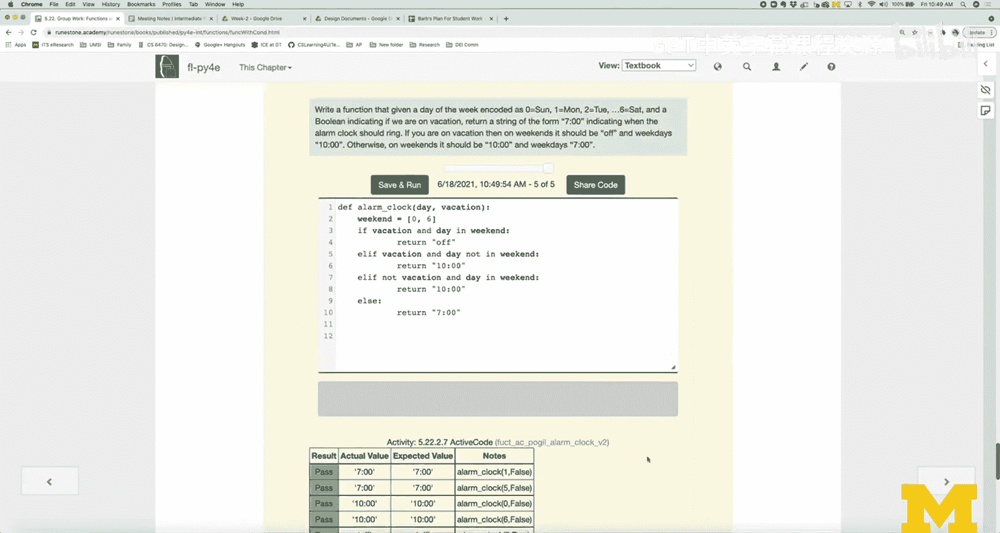

# 密歇根大学《创造性编程（创意、面向对象、debug、QA）｜Creative Coding： Hands-On Python》中英字幕 p23 22_复杂条件语句应用.zh_en -BV1ef421S7Bc_p23-

One of the ways that you can also make your code shorter is use complex conditionals。

 So whenever you find yourself doing nested if。 So an if inside of an if。

 you can replace that with a complex conditional。 So a condition。

 some bullolean expression and or some bullolean expression or or some bulloleing expression and not。

 So an's ors and knots can be combined to make complex conditionals。

 So let's see an example with the alarm clock， we have this nested conditional， If it's on。

 if we're on vacation。 And if the day is in the weekend list here， return off otherwise return。10。

 and then otherwise， if we're not on vacation， if the day is weekend， do that。

 So we can rewrite this。 So if vacation and day in weekend。Then this part would be what we want。

 then this。EF。We're on vacation and day， not in weekend。

So we can do explicit tests for each of these from where we write it as a separatepper thing。

Not vacation and day and weekend。And then we could have our else。So if we run that again。

 we see that we get the same result， but it's a lot shorter lines of code now。 Now。

 people often have trouble with complex conditionals so shorter often isn't better because the may be harder for people to understand。

 but it is one way that you can make your code shorter。

