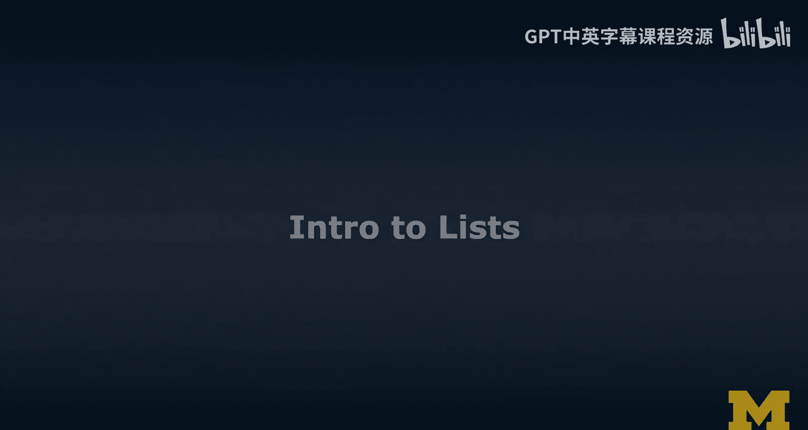
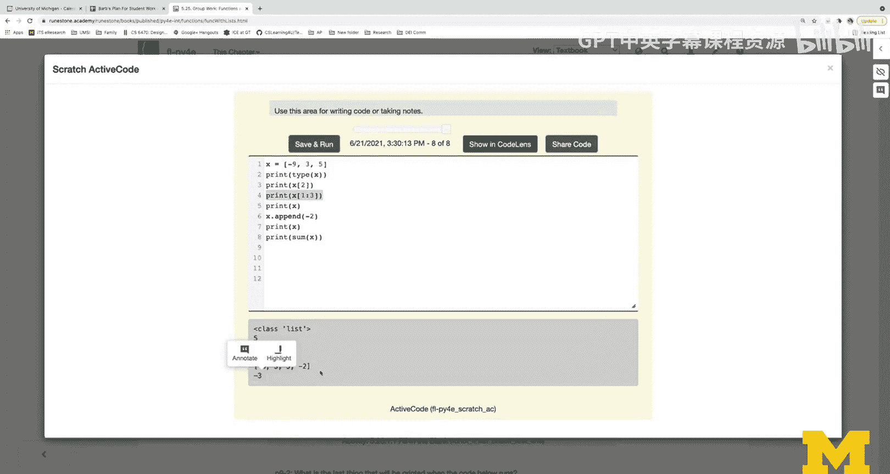
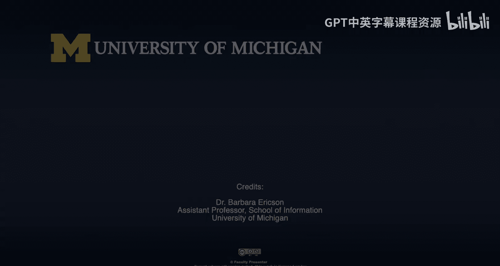
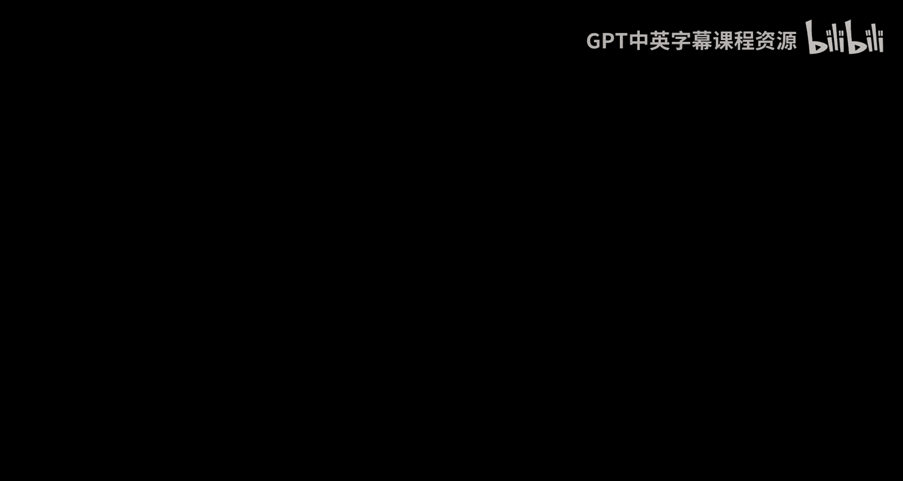

# 密歇根大学《创造性编程（创意、面向对象、debug、QA）｜Creative Coding： Hands-On Python》中英字幕 p24 23_列表综合解析.zh_en -BV1ef421S7Bc_p24-

So one of the ways that we structure or organized data is with lists and list holds items in orders。

 just like you've had a birthday list where you'd add items to a list of things that you're interested in for your birthday。

 and you could remove items。 You could say what's the first item on your list。

 What's the second thing。 So in general， we have this notion of a list that holds items in order。

 And then in Pyon。 Let's look how we work with lists and Python。 So in Python， we say。

 here's a list of numbers。 and we use the square brackets in order to show that that's a list。

 and we separate the values with commas。 And then we could print what's the kind of thing that X is。

 And then we can say we can just like with strings。

 We can use that square brackets and an index to get a value out of the list at that particular index。

 So I could get the item at index 2。I can also use the slice operator that says where to start and then where to M remember that's inclusive of the start。

 but exclusive of the end。And then I can also lists are a kind of。

Object in Python called a list class and that class knows how to do different things with list。

 and one of the things it knows how to do is append or add new things to the end of the list so we can use the append method to add something new to the list。

There's also general functions in Python that can take different kinds of collection elements like a string or a list and then tell you things like what's the length of the list。

 or if it's a list of numbers， it can tell you the sum of all the numbers in the list。

 So let's take a look at this code。 We'll go ahead and run it。And we see that， in fact。

 X is of the type list。 It's known as a list class。 and that if I print X index 2， I get value 5。

 and then if I take a slice starting an index 1 and ending an index 3。

 which is actually past the end of the list， I get back the last two elements of the list。

 And I can see if I print X again， that we haven't modified the original list。

 Remember that slice makes a copy of rather than modifying a string or a list。

 And then if I append an item to the list， I see that that gets added at the end or or the farthest rightmost side of the list。

 and then I can print the sum of all the values in a list。 If I do that。

 I'll see that I get the sum of those values。 that's a quick introduction to list。

