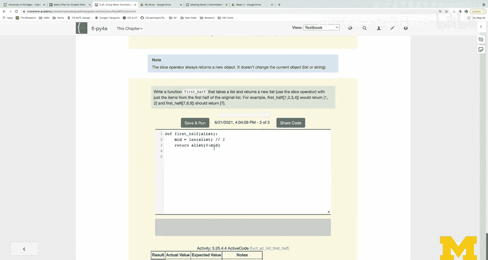

# 密歇根大学《创造性编程（创意、面向对象、debug、QA）｜Creative Coding： Hands-On Python》中英字幕 p25 24_解决first_half问题.zh_en -BV1ef421S7Bc_p25-

So hopefully you enjoyed that practice， let's go over writing the first half function。

 so in the first half function， you're taking a list as a parameter and returning a new list using the slice operator。

 which is the items from the first half the original list。So， for example。

 if first half is passed in with a list that has in it 1，2，3，4， it should return just one。

 a list that has in at1， comma 2。 and if first half is passed a list that has in it 7，8，9。

 it should return just 7。 So we're going to have to find the mid point。

 And so I'm going to create a variable called mid。Remember。

 I can use the LN or L function to figure out what the length of a list is。

 and I want to figure out what that is， that index that's going to be the midpoint so I'm going to use the integer division。

 the double division to get back an integer result。

Because the slice operator only returns an integer。 Now。

 I've got to figure out how to do my slice operator here。 So I can return a list starting at index 0。

 and I could， of course， leave that off。 It would default to 0。

 And then at what happens if I just say going up to mid， Is that correct。

 So let's look at the examples。 So if we had a list that handed at 1，2，3，4， It should return 1 and 2。

 So it should stop at index 2， which if I divide 4 by 2 integer division， I get 2。

 So that works great。 What about if it's an odd number of items。 So the list that has in it 7，8，9。

 should only return 7。So。That's three items in the list。 If we divide that by two using intergervis。

 we get 1。5 throw away the fractional part that's one。

 and that would be the value at position one would be 8。 so we only want the one at position zero。

 so again that works great。 So we can just try this and when we run it。

 we see that in fact we do pass all test cases。 So remember that you can use those built in functions like LN and that you can take slices to get pieces of lists。

