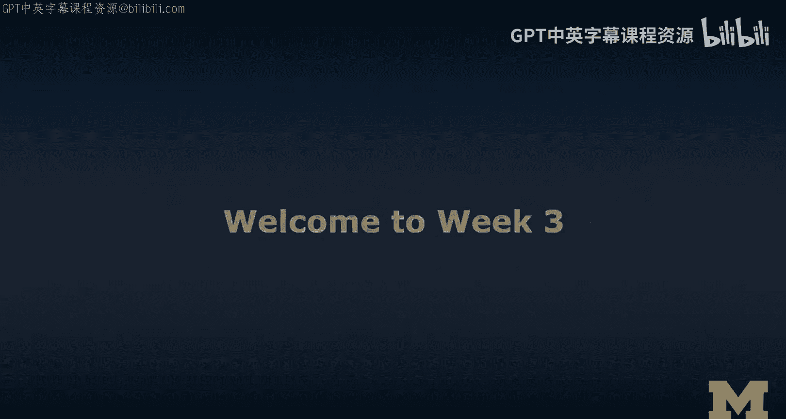
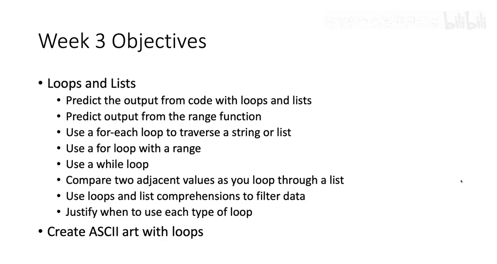
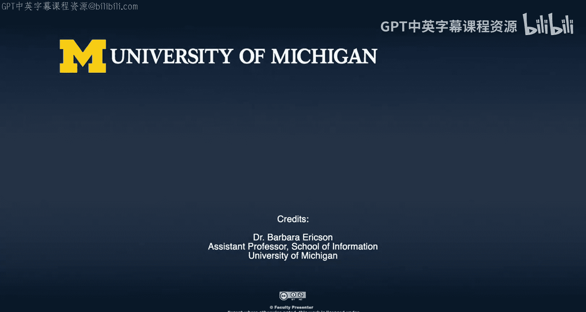

# 密歇根大学《创造性编程（创意、面向对象、debug、QA）｜Creative Coding： Hands-On Python》中英字幕 p26 25_欢迎进入第三周.zh_en -BV1ef421S7Bc_p26-

Welcome to week three。 So this week you're going to work with loops and lists。

 you're going to be able to predict the output of code with loops and lists。

 Also use the range function when you're looping through things you'll be able to use a for each loop to traverse a string or a list。

 a for loop that has a range or a while loop。You'll also compare two adjacent values as you're looping through a list。

 I'll also show you how to use list comprehensions as a way to make your code even shorter and filter data。

And then I also want you to know how to justify which type of loop you should use when you're working on a problem。

 and then for our assignment， you're going to create ASI art。

So hope you have a great time this week， enjoy。

