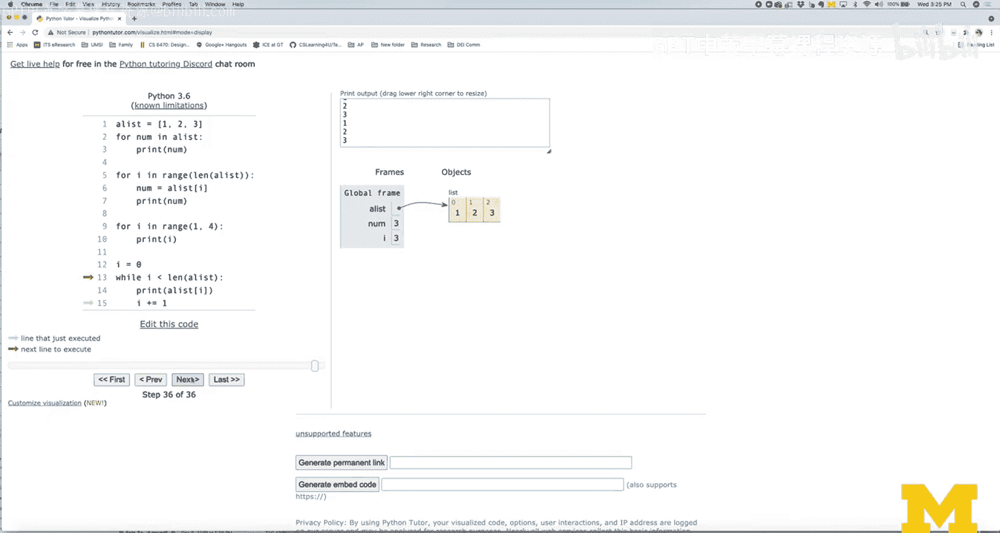

# 密歇根大学《创造性编程（创意、面向对象、debug、QA）｜Creative Coding： Hands-On Python》中英字幕 p27 26_循环结构总览.zh_en -BV1ef421S7Bc_p27-

One of the powerful features of programming is the ability to iterate or repeat a statement or a block of statements。

 and so there's different ways you can do that in Python， let's take a look at some code。

First of all， there's a for each loop that says， okay。

 for each element of a list one at a time loop through each element。

 there's also a four loop with a range that says let's loop through starting at some index and ending at some index。

 and then there's a while loop that you can use to say while some condition。

 some bullolean expression is true， execute the loop。So here。We're using a Python tutor。

 which the red arrow says what line are we about to execute。 If I click on next。

 I'll see that that line now execute。 Its green and the red line is the next line。

 So I see here there's a variable a list that has these three values。 If I click next。

 I see how nu now takes on the value  ones。 What's the first item in the list。

 and then I print that value。 And I see how numb changes to 2。 And I can print that value。

 And now I'll see when I click next again。 nu takes on the value 3， and then gets printed。

 So this prints the value 1，2 and 3。This next code does the same thing。

 but it uses the range with the length of the list as a way of doing it。

 so for I in this range and range gives you back an iterator that'll loop through some numbers and the fault is0 if you don't specify a starting position。

So this is saying loop from zero to one less than the length of this list because it isn't inclusive of that end value。

So for I range zero to。The index， the number length list is 3。 So to 2。 I'm going to see。

 get the number at that index。 and that number is one and now print it。

 So I is going to be the index value。 So we started it with 0。 Now it's 1。 We get the value。

 which is 2。 print it again。 now I is the value。 The index 2。

 We're going to get the number at that index， which is 3。 We're going to print that number。

So this is really useful when you don't want to loop through the entire list。

 when you want to loop through part of a list， then you might use this feature。

If you just want to use a set number of times or a set range of values。

 you can use the range function and the range function here we're seeing start at index1。

 so it is inclusive of that first index or the start index and stop at index 3 when I get to index3 so one less than what's guess specified which is4。

 So this will loop and each time now I is1 it'll print that now I is 2， it'll print that now I is3。

 it'll print that and then it'll stop。We can do the same thing with a while loop。

I can set a counter I equals 0。 I can loop while I is less than the length of list again。

 which is three。 So y it's less than3，0 is less than3。

 We can print the value of the list at that index。 So the index 0， we get the value1。

 can we have to increment one， the index by one。 Otherwise we would never change which one we're working with。

So now we're at index one。That is still less than three。

 We're going to print the value at that index and increment I。 So now it's two same thing。

 we're going to get the value at that location and increment it。 So now it's3。

 And so now it's going to fail those while I is less than the length of the list and will be done。

So those are at least three different ways that you can loop through material or blocks of code in Python。

