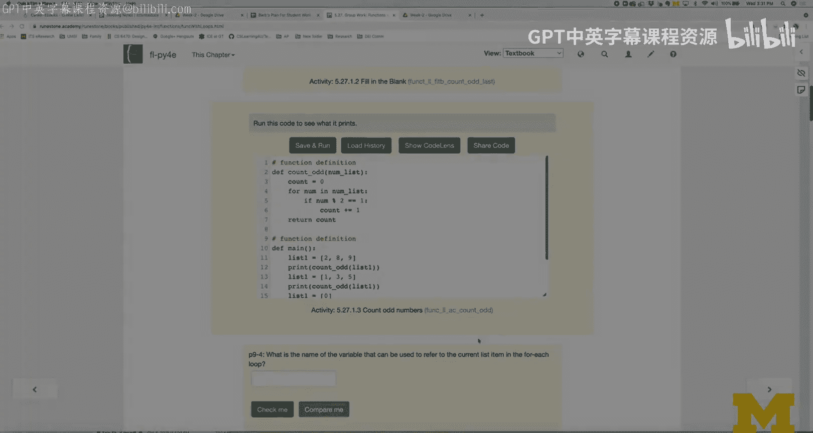
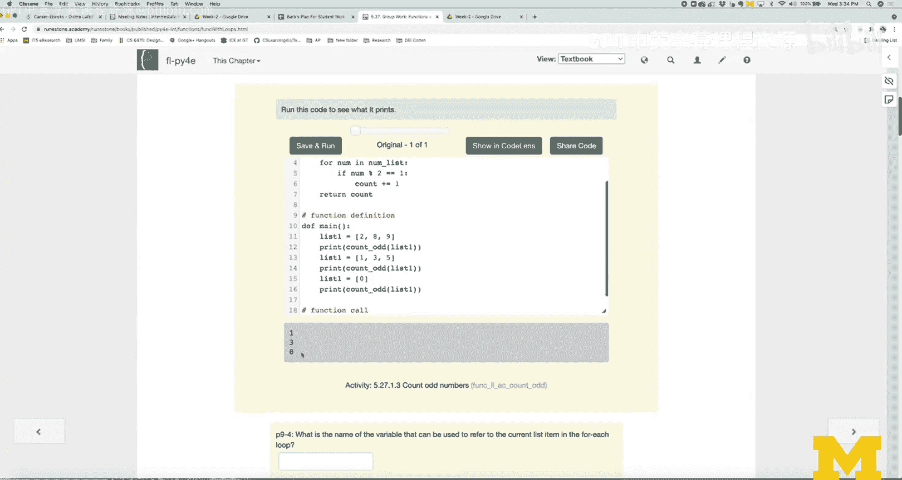

# 密歇根大学《创造性编程（创意、面向对象、debug、QA）｜Creative Coding： Hands-On Python》中英字幕 p28 27_单步调试count_odd函数.zh_en -BV1ef421S7Bc_p28-

So here we have count odd that takes it a number list starts count as 0。

 and then for nu in the number list。 So for each number in the list， if that number modo2。

 so with the remainder when I divide it by 2 is equal to1， which means it's odd。

 then increment the count and then return that count。

So let's see what happens when we use the code lens to walk through this code。

It can take a moment for the code lens to load。When you load the code lens。

 you're really loading a version of the Python tutor directly here in the ebook。

 And we'll see this red line that shows the line that's next to execute。

 And then once we execute that， we'll see that turns green to show that that just executed。

 So the first thing we do is define that function。 So we see we have our function defined。 Now。

 we'll define the main method。 So if I click next， we'll see that that'll skip through down to the actual call the main。

 So now we'll actually call the main function。Which will invoke it。 So we go back to line 10。

And now we're going to create this list， list 1。 we see that gets created with the values here and nicely drawn with the indices。

 And then we're going to print what's the result of calling count odd on list1。

 So we're going to go into this count odd function。And when I say next。

 we'll go down to set count to 0。 so we'll see that count to 0。

And then we're going to start looping through the list。 So for numb in numb list means one at a time。

 take the elements of numb list and set them to numb。 So the very first element the first time。

 So this two is what numb is first。Now we're checking is two divided by two equal to one。

 is it an odd number， no， it's not， so don't increment count。Again， we're coming back up。

 So we're going to look at the next value in this list。 So we look at8 is 8。Modulula 2 equal to1。

 no8 is even， so does an increment count？And now we're going to go through the last element。

 which is 9。 So we see that nu is 9。 Now， we're going to check to see if that modular 2。

 So if divided by 2， do I have a remainder， that's one， that's true because 9 is odd。

 We're going to increment the count。 count sacrament to one。 and now we're going to return the count。

 So we return the count。 When we come back from that。

We will go back to this we will print the output， so you'll see here the output of that return。

 so we got one as the number of odd dims in that list。

And we could just hit last or we can just keep saying next to go through the next one。

 So now list is equal to 1，3，5。 Notice that I can change the value of list 1。

 so I just change what it refers to。And so now when I call it。Numb underscore list is that list。

And whoops。Sorry， clicking on the wrong thing。And we can walk through that。

 But now you can see how you can use the code lens and you can just hide the code lens when you're done with it and you can just save and run it to see the entire items。

 So we can see that the first time we call count odd， we get a value of one。

 then it's a value  three because all three of those are odd and then zero because none of those are odd zero is not considered an odd number。

So remember that you can use the code lens button to walk through your code。

 which can help you when you're debugging。