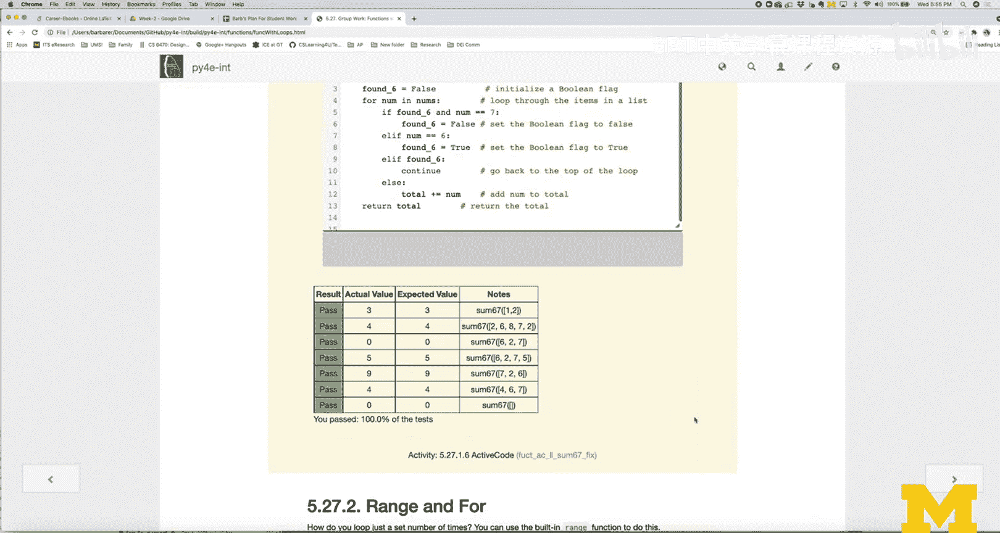

# 密歇根大学《创造性编程（创意、面向对象、debug、QA）｜Creative Coding： Hands-On Python》中英字幕 p29 28_修复sum67函数.zh_en -BV1ef421S7Bc_p29-

So let's take a look at the function Ps67。So in F sum 67 you're supposed to fix the errors。

 you can always go ahead and run your code and see what line number you're gonna to have problems with so it says bad input on line 5。

 So it found and one of the difficulties you're going to have if you've been working in a different language is that Python uses and rather than Ampersand Ampersand like Java or C++。

So that's one of the problems， line7， it should use double equals to test for equal。

And then now we compiles， but we still have failure。 So some things are not right。

 So let's go back and look at the code here。 So what it's supposed to do is take a list。

 nus and returns the total items in the list， except for all the numbers between a 6 and a 7 inclusive。

 So for example， some 6，7 to 1，2 should return 3 because there's no 6 or 7， but some 6，7 of 2，6，8，7。

2 should return 4 because you're going to ignore everything from 6 to 7 Okay。

So we define the function。 It takes in a list of nus。 We set total to 0， foundund 6 equals true。

 Well， it shouldn't start off at true， because that's not what we'd want。 We haven't found one yet。

 So let's start it off at false and see if that fixes things。 Well， it fixes some things。

 but not everything。 All right， So let's continue through。

So we loop through the list for numb and nus， if we found six and number equals seven。

 then we set found six to false so that what we're doing is setting a flag when we find six and then we're ignore everything between that six and that seven and then once we find the seven that we' turn the flag back to false that's okay。

Else， if N is equal to 6， well， then we set the flag to true， so that's good。If we found the six。

 then we continue， meaning skip the rest of the loop and go back to the top， which is fine， right。

 so we don't need if if we've found a6。 So that means we're between the six and the7 because we've already checked to see if it was7 or if it was 6。

 So that means it's something between a6 and 7。 So we're just going continue to skip that。

 Otherwise we add it to total。 That's great。 Oh， but then we immediately returned total。

 but we really need to loop finished the loop。 So that should not be indented。

And so now we've passed all the unit tests， so that's how you fix that function。

