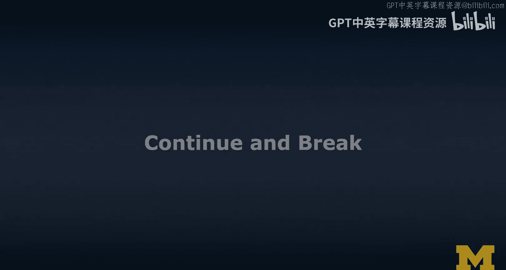
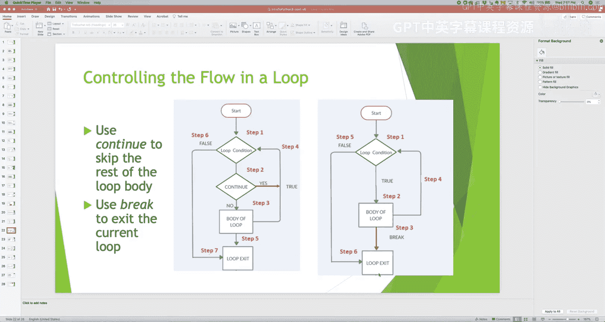
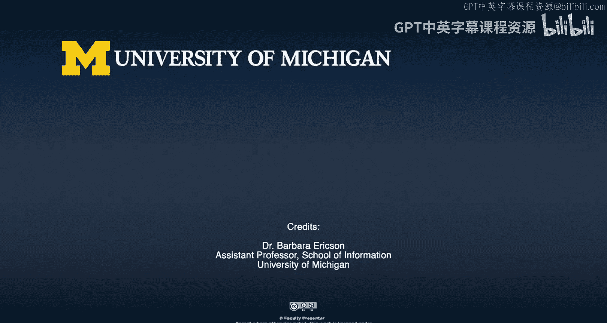

# 密歇根大学《创造性编程（创意、面向对象、debug、QA）｜Creative Coding： Hands-On Python》中英字幕 p30 29_循环进阶技巧.zh_en -BV1ef421S7Bc_p30-

So there's a couple of things that you can use to change the control flow in a loop。

 And one of those is continue。 And so you can have a loop that， of course， you start your loop。

 you have a condition on your loop。 and as long as the loop is that condition is true。

 you're going to execute the loop。 And if in while you're executing the body of the loop。

 you find a condition I mean a continuous statement。

 what happens is that jumps back up to the loop condition。

 So it ignores the rest of the body of the loop， you sort of skip that piece and go back up to the loop condition and when the loop condition is false。

 then you exit the loop。 So that's a continue。You can also use a brake to exit the current loop。

 So for example， if you said while true， that would be an infinite loop unless you broke unless you had a break at some point in it。

 So if you start your loop， you have a loop condition， if it's true。

 you go into the body of the loop， if ats some point in that body of the loop， you have a break。

 that'll immediatelyly exit the loop。 So if it was a nested loop。

 it'll just exit whatever loop the brake was in so you can use both continue and break in your code。

