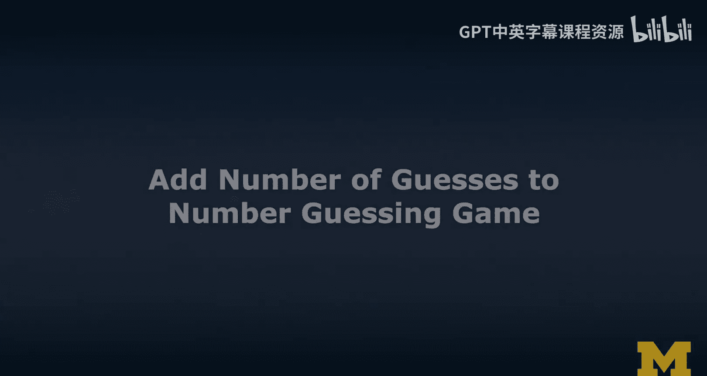
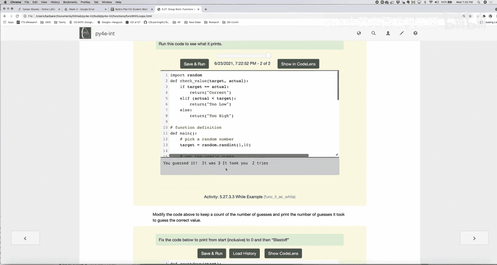

# 密歇根大学《创造性编程（创意、面向对象、debug、QA）｜Creative Coding： Hands-On Python》中英字幕 p31 30_为猜数游戏添加尝试计数.zh_en -BV1ef421S7Bc_p31-

So one of the great places to use a while loop is when you don't know how many iterationss going to take。

 For example， in a game， you don't know when somebody is going to win。

 So if we do a simple number guessing game， pick a number between1 and 10 where you get feedback about are you correct。

 Are you too low or too high。 You can use a while loop to say， as long as we haven't won。

 You're not correct， Let's keep playing the game。 So let's look at this code。😊。

So we import random in line1， that's the module that defines the pseudorandom number generator。

 and we define a function check actual check value that takes a target and actual and checks if the target is equal to actual returns a string correct otherwise or else if actual is less than target return。

 the string too low。Els return the string too high。

 And then in our main method or main function here。

 we pick a random number between  one and 10 inclusive。 We get the user's guess。 So nu equals。

 we have to cast it to integer because it would be string。Normally when you ask for input。

 it comes back as a string。 So we ask the user to enter a number between  one and 10 inclusive。

 We get the result into result by calling check value。 Remember that returns a string。

 And then we check while result is not equal correct。 While you havet won。Then we're going to。

Increment， we're going show you the result。 plus ask you enter another number and then get the result again from that。

 So that'll keep looping until you get it correct。 Once you've got it correct， you're going say。

 okay， print， you guessed it it was whatever。 and then were callinging the main method to start this。

 So let's if we execute this。 It asks us to enter a number。

 So one of the smart ways of trying to guess a number between one to 10 is to break it in half。

 So let's start with5。It says too high。 So it means we have to do the lower parts。

 So between 1 and 5。 So we could break that in half。 that's 2。5。 but we can't guess 2。

5 and guess 2 or 3。 I'll guess 3。 That's still too high。 Let's try 2， too high。 Let's try one。

 It was one。So one of the things we've asked you to do here is modify the count keep count the number of guesses。

 So in the main function here is where we're keeping track where where we're looping。

 So let's let's first initialize a variable。So。I'm going to call it nu underscore guesses。

 it's important to name things what they actually are。

And we're going to initialize that to zero because you haven't guessed anything yet。

Or you have guests， but we don't know whether it's correct or not。

 We might initialize it to one then because you are entering the input here。

 So you are guessing before you ever get here。 So if you got it correct immediately。

 that would be one guess。 so we want to start at one rather than 0。And then every time you're wrong。

 we should increment the number of guesses， so inside the while loop increment。Noumb guesses。

And we can do that by saying numb guesses plus equals， so equals itself plus one。

And then we could modify right now， notice we're just printing out we using the print statement。

 a string， comma， the target， and that converts。Numbers to strings for us automatically。嗯。

And puts a space between them。Noops。Noumb guesses。Let's try that， see what that does。

So now we've put a lot of commas between these to see what happens。 So I'm going to guess five again。

 that's too high。 Let's try three。And it says， you guessed it。 It was three and it hook you2 tries。

 And that was my second guess。 So that's working correctly。

 So that's one way we could modify this function。

