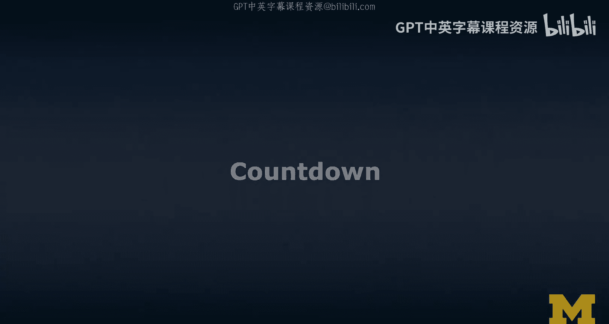
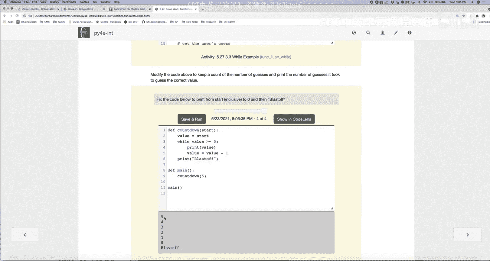

# 密歇根大学《创造性编程（创意、面向对象、debug、QA）｜Creative Coding： Hands-On Python》中英字幕 p32 31_修复倒计时程序.zh_en -BV1ef421S7Bc_p32-

So let's take a look what's happening with the count down function。 So here's the count down。

 says def countdown that takes a starting value。 Then value gets set to that start value。

 long as value is greater than 0。 So while values is greater than 0。

 print the value and then print blast off。 Notice one problem is it should have string。

 which we should have strings around that。 But let's see what else happens if I try to run this。

Then we define a main method that calls countdown。 If I say save and run。

 I'll see that nothing much happens。 Well， why not， in part， what we've done is define to function。

 we never called any。 so weve got to make sure we actually call the main so I'm going to call the main method if I try to call the main。

Again， nothing seems to happen and what's going on here is what's called an infinite loop。

We say value equal to 5 to start， and then we never modify it。 So value is always greater than 0。

 At some point， it might come back and say this page is unresponsive。 Here it is。

 You can wait for it to become responsive or exit the page。 I'm going。Exit the page。

 reload the page is another thing you can do when that happens。

So that's a very common error when you're using while loops。

 especially if you want to make sure that you need to make sure that there's not you're not stuck in an infinite loop but a loop that never ends So let's fix this carrot again。

 Let's make sure we call the main。And let's set the value So we want to print it first because we want to count down。

 and then we'll so we'll modify value equals value-1。 So we'll bring it down。

 So if we try to run that。 Oh， we forgot to modify blast off。 So that's a string。

 Let's try that again。Alright， so now're， we're counting down， but we did 5 to1， actually。

 because we did value greater than 0。 So we actually want to change that to greater than or equal。

 So now it' would actually count down from 5 to 0 and then print the string blast off。

 That's how you can fix that function。

