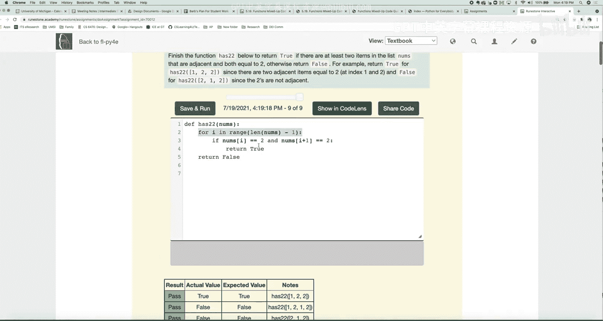

# 密歇根大学《创造性编程（创意、面向对象、debug、QA）｜Creative Coding： Hands-On Python》中英字幕 p33 32_列表相邻值比较方法.zh_en -BV1ef421S7Bc_p33-

So one of the things that can be a little bit difficult is comparing two different values as you're looping through a list。

So one of the things you can do is loop through a list using a。An index。 And that way。

 you can compare one item with its adjacent item。 So let's take a look at that。

 So finishing the function has 22 to return true。 If there's at least two items in the listnos that are adjacent。

 both equal to 2， otherwise return false。 For example， return true。 If has 22。

 it has a list of one comma 2 comma 2。 Since there's two adjacent items that are both equal to 2。

 So we have an index 1 and index 2， they're both two。 and false， if we have two comma 1 comma 2。

 because the twos are not adjacent。So one of the things you can do is loop through this list item at a time so we can use。

Instead of using a for each loop like we've usually been using where we don't have the index。

 we're going to loop through using the length of this thing using a range in order to get all the indices from 0 to one less than the length。

 so we can say for I or index in range of length of nus so that should give us from0 to one minus the length of the things。

 and then now we have our index， and we can say if value if nus of I。

So if we're starting at zero and we're looping all the way to the end。

 that raises a little bit of an issue because we're comparing one to the next so we can't loop all the way to the end。

 so what we're going to do is the range of that minus1。

So if we're going to say if the nus of I is equal to2 and if nus of I plus1。

 so we're going to look at one of them versus the one next to it is also equal to2。

 then we're going to return true。Otherwise， if we get all the way through and none of those are true。

 then we get all the way and we say return false， oops， else， return false， os。

Or you could just say return false here， you don't have to have the else because if it was true。

 it would have already returned， so let's try that。Num is not defined。

 Where did I use numb there it is。A couple places I did that。There we go。

 so that's one way you can do it。You got to be careful here about not going out of bounds。

 so this is a good example of when you don't want to use a4age loop so you don't use a4age loop if you want the index of the thing。

 so instead you can use an index and you can get the current index using the range thing。

 but you want to make sure you don't go out of bounds。

So that's one way to loop through a list and looking at each item and its adjacent item。

