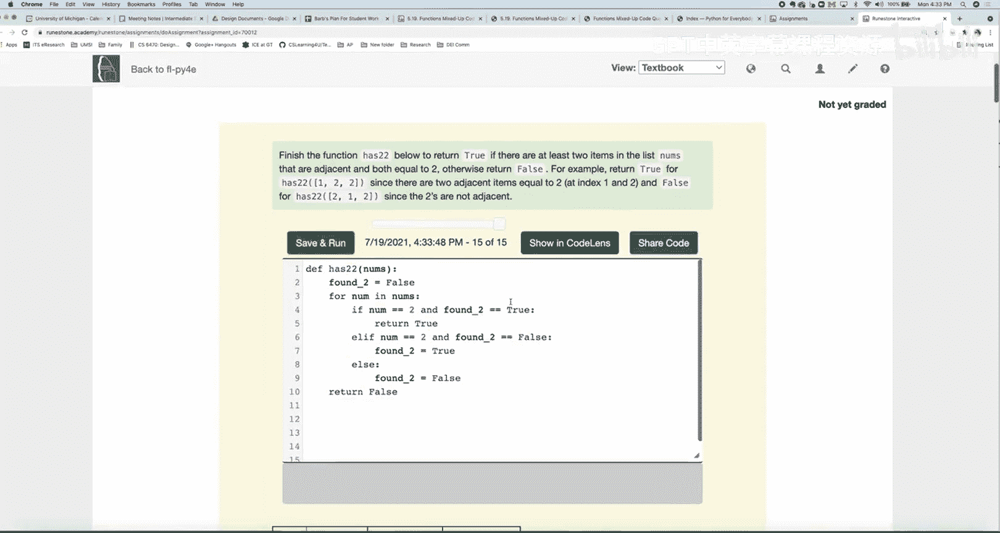

# 密歇根大学《创造性编程（创意、面向对象、debug、QA）｜Creative Coding： Hands-On Python》中英字幕 p34 33_相邻值比较替代方案.zh_en -BV1ef421S7Bc_p34-

So let's look at another way you could solve hasS 22。

So you could loop through every item using an index again。

 so you could say or you could just loop through every item， so you could do a set of Boolean。

 you could say Boolean expression， so I could say， did I find a two basically found to and start that off as false。

Remember that the Boolean values of true and false start with a capital letter in Python。

 and then I could now loop through for nu in nus。And I could say if nom is equal to2 and found two is true。

Then return true because now that I that means I've already found a two and and Jason。

 the last thing I checked was a two and this thing is a two。 so go ahead and return true。 El if。

 we found a two and found two is false。We want to set found two to true because we found one now。

And then， otherwise。We're going to reset。 That means that numb 2 isn't The current number isn't a2。

 So otherwise。We can reset found two to be false。And if we get all the way through that loop and we don't find anything。

 we can just return false。Excuse me。So if we try that that works as well。

 so that's another way that you could solve has 22 using just a four each loop rather than trying to use the indices。

