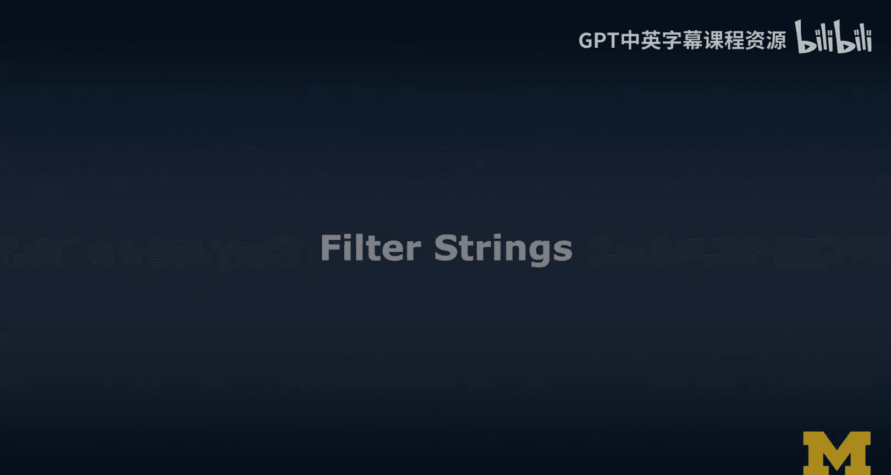
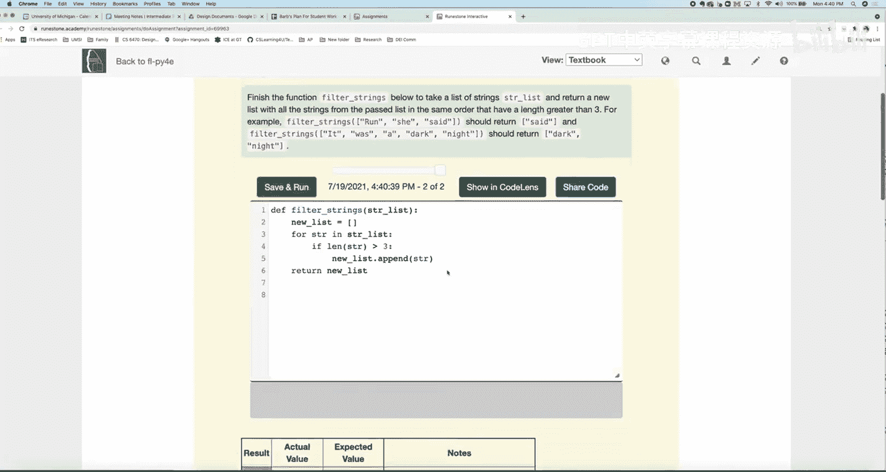
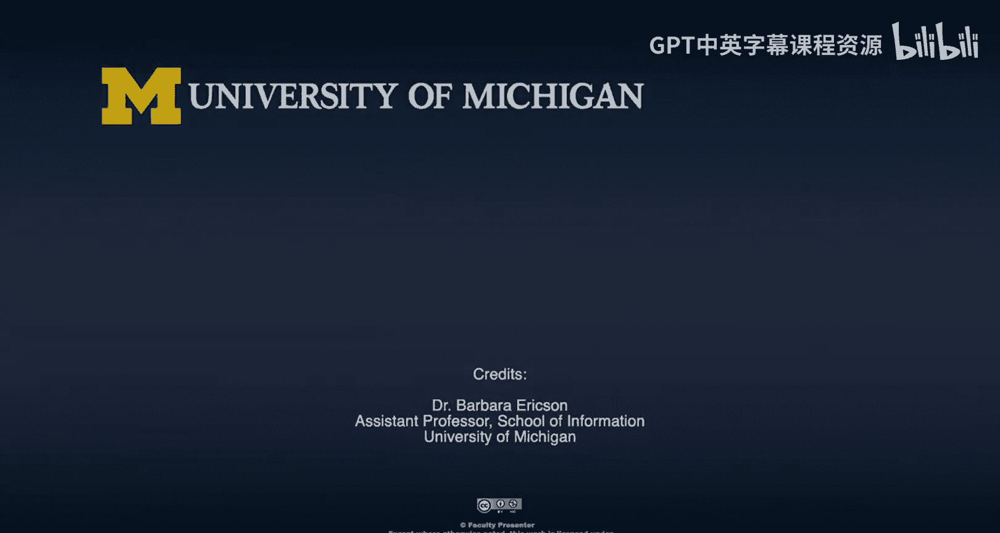
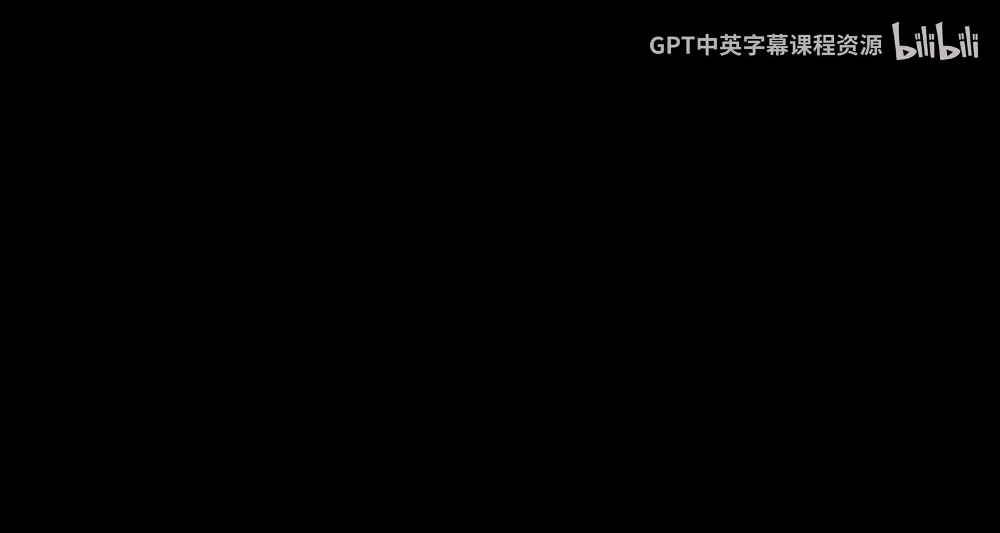

# 密歇根大学《创造性编程（创意、面向对象、debug、QA）｜Creative Coding： Hands-On Python》中英字幕 p35 34_循环数据过滤技术.zh_en -BV1ef421S7Bc_p35-

One of the things that is useful to with lists is looping through a list and filtering out things。

 so often creating a new list from the original list let's look at an example of that。

So we're going to finish the function filter strings that takes a list of strings called SR underscore list and return a new list。

 So we're going to be creating a list with all the strings on the pass list in the same order。

 So as we loop through them that have length greater than three。 For example。

 filter strings with the list run she and said should return just said because that has length more than3。

 So let's try that。 So we're going to create our new list to return。

 So I can just call it new list if I want and start it off as an empty list and then I can loop using a for each loop for each string in string list。

😊，If the length of it is one the way I can check to see how long this thing。

 length of string is greater than three。Then I'm going to add it to my new list。

 So the way I can add to a list， one of the ways is using a pen dot a pen。That'll add it at the end。

 and then I can return my new list。 Now， you've got to make sure you return the new list。 Otherwise。

 this doesn't do a whole lot of good。 So let's try that。

So that's one way you can filter a list you walk through every element of the list。

 if it meets your criteria， you add it to a new list and then return it。

