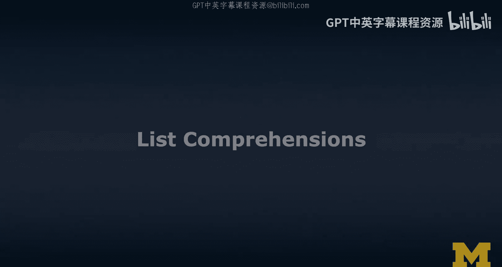
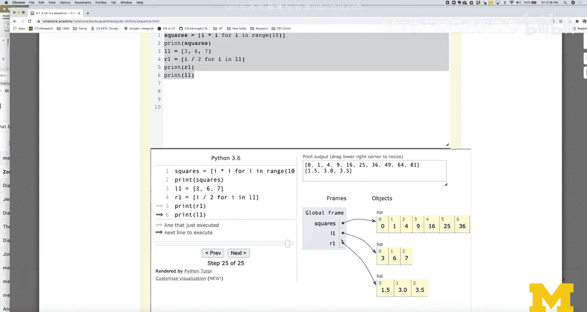

# 密歇根大学《创造性编程（创意、面向对象、debug、QA）｜Creative Coding： Hands-On Python》中英字幕 p36 35_列表推导式解析.zh_en -BV1ef421S7Bc_p36-

One of the interesting features of Python is something called list comprehensions。

 This is an easy way to create or modify a list in Python。 Let's look at the。Syntax for this。

 So what it does is create a new list。 So you're going to name the list that gets returned from it。

 So some new list equals， and then square brackets like you would use for lists。

 some expression for a member in a iterable object。 And what's an iterable object。 Well。

 things like list are things you can iterate over or loop through。 samee thing with range， range。

 return something that you can iterate through。 You can ask it for the next， next。

 next thing in the range and it'll let you loop through that or iterate through that。

 So let's look at this code。And we'll show it in a code lens。

So using the next button in the code lens， we can see that we're starting off creating the squares by creating this range iterator instance。

And then we're looping through I in that range。 right。 So if I say range of 10。

 I get back the values from 0 to 9。 So I is 0， first， then 1， then 2， then 3， so forth。

 all the way up to 9。And now we see the list that was generated by that。

 So for each value from 0 to 9， we'll set an item in the list with the value of I times I。

 So 0 times 0 is 0，1 times 1 is 1，2 times 2 is 4，3 times 3 is9。 So we have a list of squares。

And then we can print that list。So we'll print the result， printing the squares。 Now。

 let's create another list， L1。 And what another thing that you can use list comprehensions for is to modify a list or to give you a new set of values from the list。

 You're actually not changing the list。 You're getting a new set of values。

 But if you wanted to create a new list by modifying an original list， you can do this。

 So here we're saying set R 1 equal to the list return from I divided by 2，4 I in list 1。

 So this is going to loop through。We see。 I starts off at。3。

 so we're doing a four each loop for each element of that list and this is our list 367 so I is 3。

 then I is 6， then I is 7， and now we return the new list。

 so now our1 equals this new this list that has it at 1。53 and 3。5。

And we can print R1 and we can see here that R1 and L1 are different things。

 but also we can print to see that they're different。

So that's a little bit about list comprehensions。

