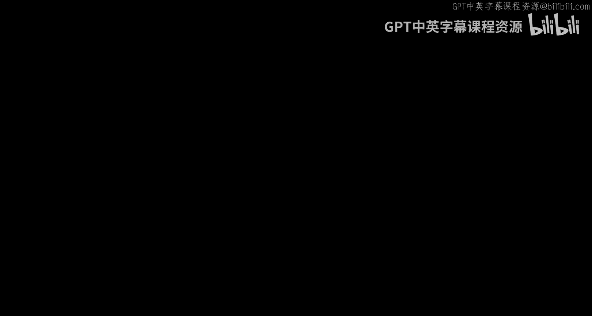
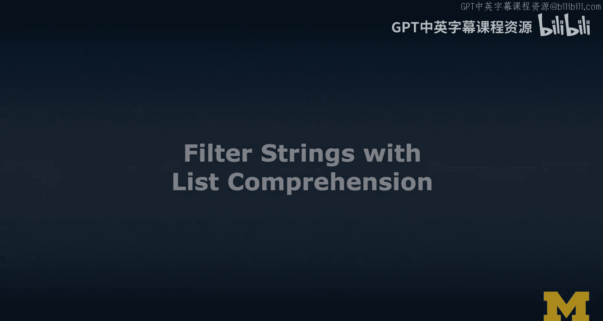
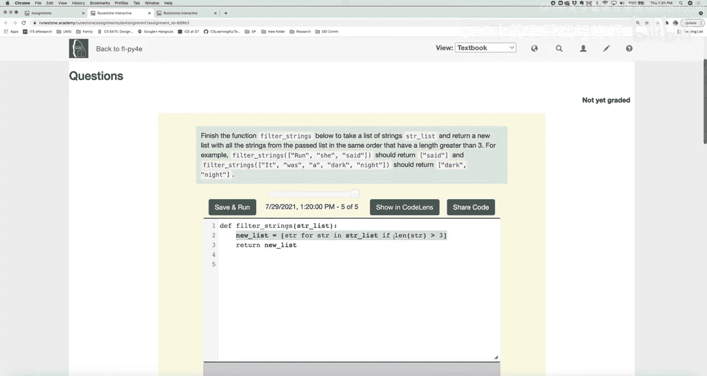

# 密歇根大学《创造性编程（创意、面向对象、debug、QA）｜Creative Coding： Hands-On Python》中英字幕 p37 36_列表推导式数据过滤.zh_en -BV1ef421S7Bc_p37-

So we've just walked through one way to solve the filter strings and what we did， of course。

 is create a new list that was empty and then use a4 eachch loop to loop through every string in this list of strings that was passed in。

 And if the length of that string was greater than three。

 we appended it to the new list and then we returned the new list。

 I'm going to show you how to make that a lot simpler using something called the list comprehension。

So the list comprehension what we say is we want to basically figure out all the code inside this area when we're creating the list。

 so we're saying new list equal and what we're going to want is we're going to have a string for each string for SDR in SDR list so as a way to loop through that and then we can add a conditional here if the length of SDR is greater than three。

And if I just and then I want to return that new list。And if I do that。

It also passes all the test cases， so we've got rid of quite a bit of code。

 but doing something very similar， just written in a shorter form。So we're saying。

 create this new list out of strings where we loop through for each string in this original list and only include it in this output list if the length of string is greater than three。

 So that's one way you can make your code shorter using list comprehensions。

