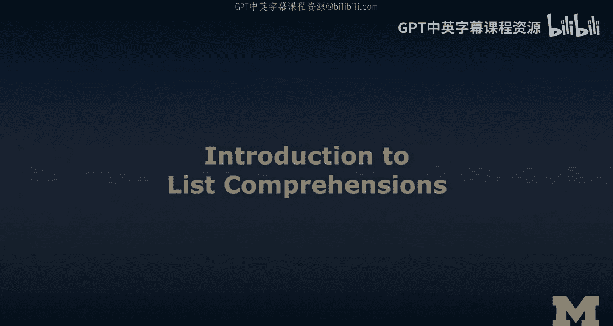
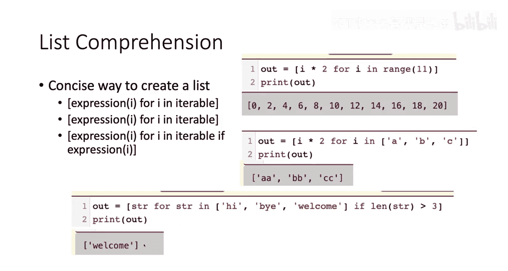
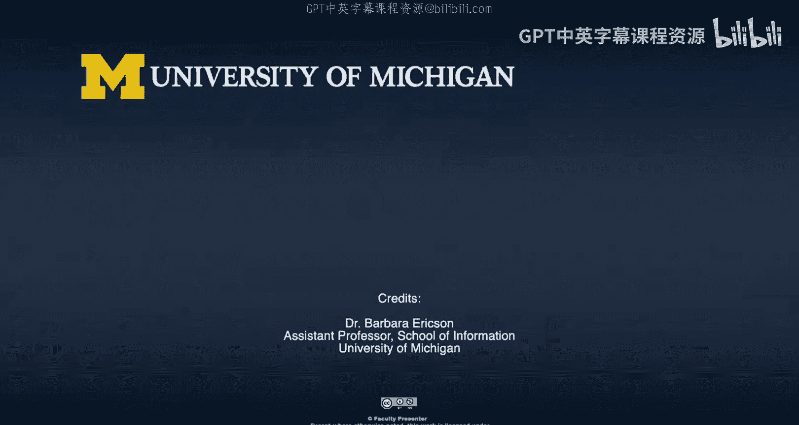

# 密歇根大学《创造性编程（创意、面向对象、debug、QA）｜Creative Coding： Hands-On Python》中英字幕 p38 37_列表推导式进阶应用.zh_en -BV1ef421S7Bc_p38-

So let's talk a little bit more about list comprehensions。

 And they're a concise way that you can create lists。

 And the general idea is you can use some expression for I in some iterable。

 and therefore you can create a new list from that。 So let's look at an example。

 So here I say out equals。 and I use the square brackets to start the list comprehension。 I times 2。

4 I in range 11。 And what that's going to do when I print out is give me back the list So the range function。

 of course， goes from 0 to 10。 So one less than what the last thing is given。

 And it's going to return I times 2。 So 0 times 2 is 0，2 times 2， two times 1 is2。

2 times 2 is 4 and so forth up to 2 times 10， which is 20。

So that's an easy way to generate those numbers as a list。Another thing， of course。

 I can use instead of the range is an actual list， or I can use a variable here that refers to a list that was created earlier。

 So here I'm saying I times 2 for I in this list of strings。

 and I can multiply strings which just duplicates them。 So when I print the output。

 I see a list with the A doubled A A， the B double B B。

 the C doubled C can also use a conditional in a list comprehension。

 So here I say out equals string for string in this list of strings if the length of string is greater than3。

 and that'll let me create a new list that filters out any strings that are less than length 3。

So that's a quick introduction to list comprehensions。

