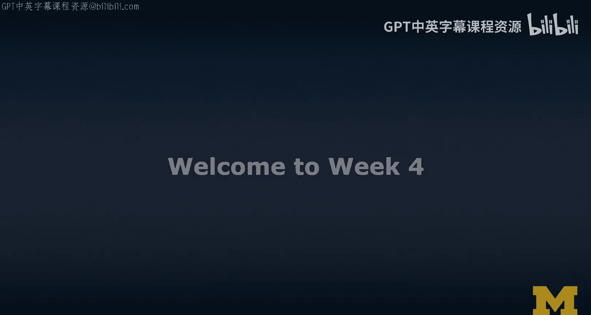
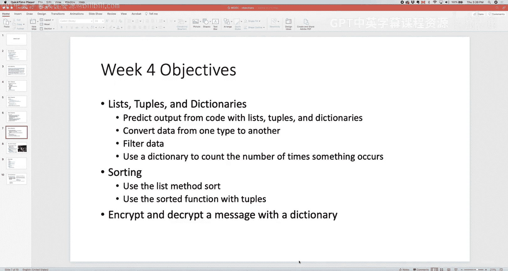
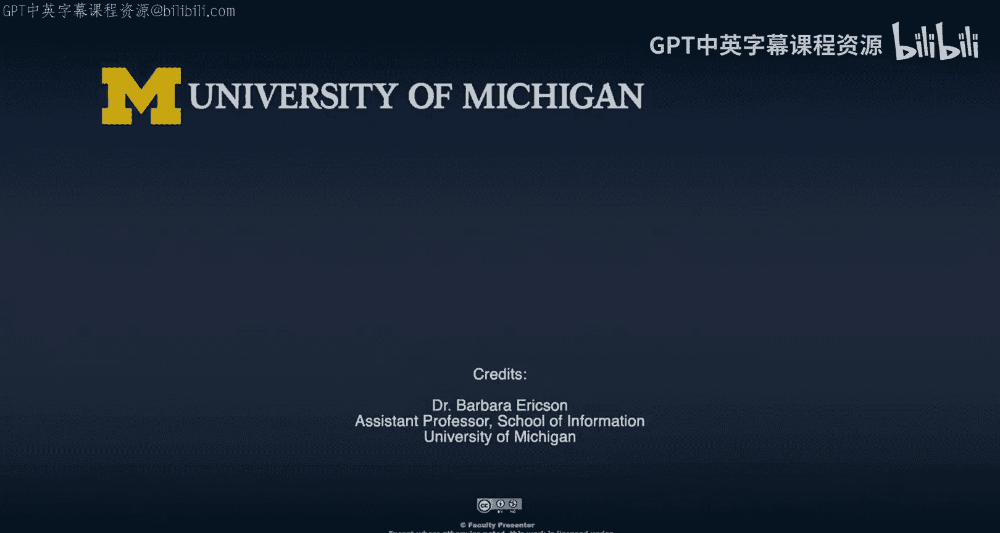

# 密歇根大学《创造性编程（创意、面向对象、debug、QA）｜Creative Coding： Hands-On Python》中英字幕 p39 38_欢迎进入第四周.zh_en -BV1ef421S7Bc_p39-

In week4 the last week of this course。 this week， you're going to concentrate on the basic data structures in Pythonons。

 So list tuples and dictionaries。 We're going to talk about how do you predict the output from。

 or you're going to learn how to predict the output from list tuples and dictionaries。

 how to convert things from one type to another， how to filter data。

Whi is part of data cleaning for data science or data analysis you're going to use a dictionary to count the number of times things occur you're also going to learn how to sort because one of the things with data science or data analysis is we want to know what are the top of something or the bottom of something what's the top five states for something or the bottom five states so sorting is a great way of figuring that out。

So we'll use the built in list function sort and we'll also use the sorted function that works with tuples and with dictionaries you can get a list of tus from their items。

 their keys and values pair so how to sort those and then for your assignment you're going to encrypt and decrypt a message using a dictionary have a great time。

