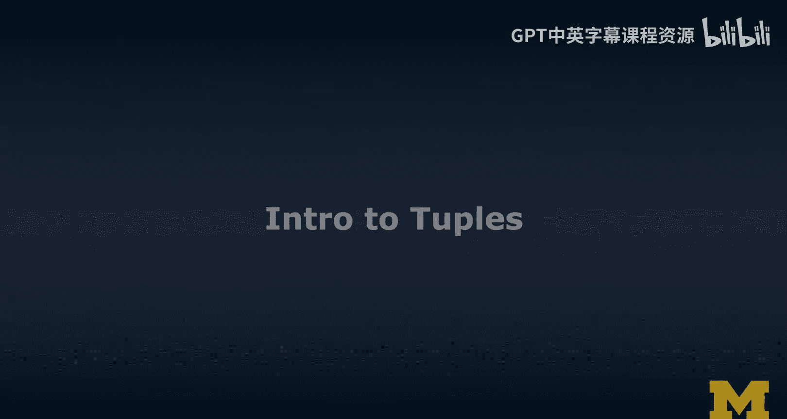
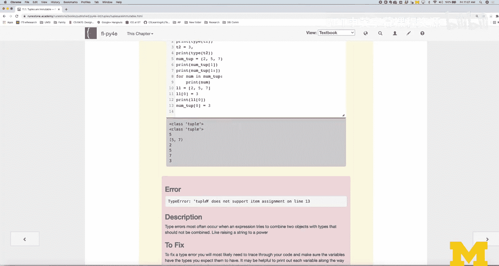
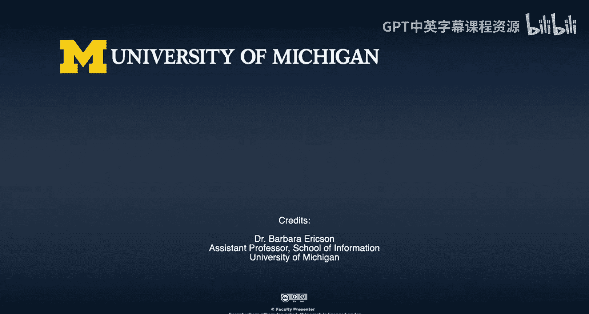

# 密歇根大学《创造性编程（创意、面向对象、debug、QA）｜Creative Coding： Hands-On Python》中英字幕 p40 39_元组综合解析.zh_en -BV1ef421S7Bc_p40-

We've been working with lists， which holds items in order。

 There's another data structure that's very similar to a list called a tuple。

 and it also holds items in order。 And typically， it's a list of items separated by commas or a collection of items separated by commas。

 Let's take a look at this。 So I'm going to show it in code lines。 We can see what happens here。

So the first thing we're going to do is declare a tuple with just one item in it。

 and notice we declare it with an item followed by comma that's because。

We don't actually have to have parentheses， and it needs to be something separated by commas。

 So we have to have that comma， even if there's only one item in the tuple。

 We can print what's the kind of thing this is。 And it's of class tuple。

 We can create another one without the parentheses。 parentheses are optional。

 but we do have to have a comma。 Then We see that it' also a tuple。 and when we print this type。

 We see that that's a tuple。We create another tuple with 2，5，7 in it。

 We see that it looks very similar to a list。 indexing starts at 0。 And just like a list。

 I can get an item at an index。 So the item at index 1 is 5。 As we see here， when we print that。

 we can also use slice to create a new tuple， doesn't modify the old one。And starting in index 1。

 So we see the tuple with 5 comma 7。 And we can loop through all the items in a tuple and one at a time print those out as well。

 So that's how listen to tuples are similar。 How are they different。

 Why do we have another thing that does the same thing as a list。 Well。

 the big difference is you can't modify or change a tuple， and you can list。

 So we have been able to do before， L 1 equals。 Remember， we use square brackets for list。 So 2，5，7。

 If I do that， I can do things like L 1 of0 now equals 3。And I can print L1。

Of zero to see what's changed。嗯。So I see that， I see now that' it's been changed to three。

 but what happens if I try that on a tuple？I'll get an error because tuples don't allow you to change them so it sort of like strings。

 strings are immutable， you can't change a string， anything that we do to strings like changing an uppercase or lowercase actually creates a new string tuples you just can't change period you can't do things like a pen to them they aren't lists。

 they're a different data structure so that's an introduction to tuples。

