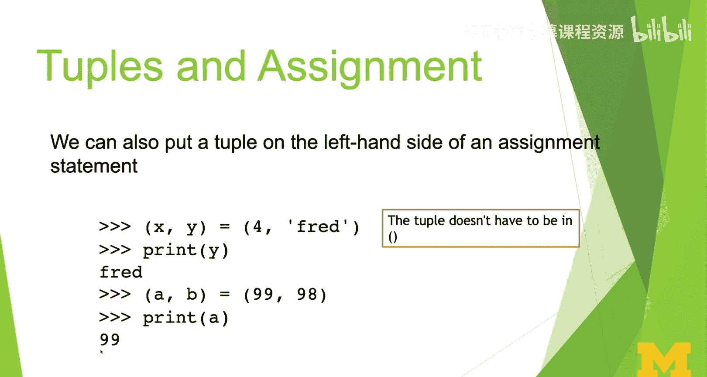

# 密歇根大学《创造性编程（创意、面向对象、debug、QA）｜Creative Coding： Hands-On Python》中英字幕 p41 40_元组使用场景.zh_en -BV1ef421S7Bc_p41-

So if tuples are a lot like lists， but you're just not changeable， what's the point。

 So the point is that they're a lot more efficient。 So when you're returning values。

 one of the nice things you can do in Python that you can't do in a lot of other languages is return a tuple of several items。

 So rather than just return one return value And because you don't want anybody to modify or change it it doesn't have to be a list。

 it can just be a tuple or if we're working with a dictionary and want to get get a tuple of the key and value pairs。

 again， we don't want anybody mess with that because we got it from the dictionary。

 I don't want you to change it。 So it makes things much more efficient。

And another thing to note is when you're working with tuples is you can assign a tuple on the left hand side to two values on the right hand side。

 So if I was returning multiple values to from a function， I could do that on the left hand side。

 I could have a tuple with several variables listed。 And if the function returns several variables。

 each of those variables， then we get the correct value。 So that's a handy feature。Notice， of course。

 the tuple doesn't have to be in parentheses。 So here。

 if we say the tuple of x comma Y is equal to a tuple 4 comma Fred， and we print the value of y。

 we see Fred。 If we had printed x， we'd see 4。 If we say the tuple A B is equal to 99a 100。

 That tuple and printing A would give us 99 and B would give us 98。

 So here's one reason why we use tuples。

