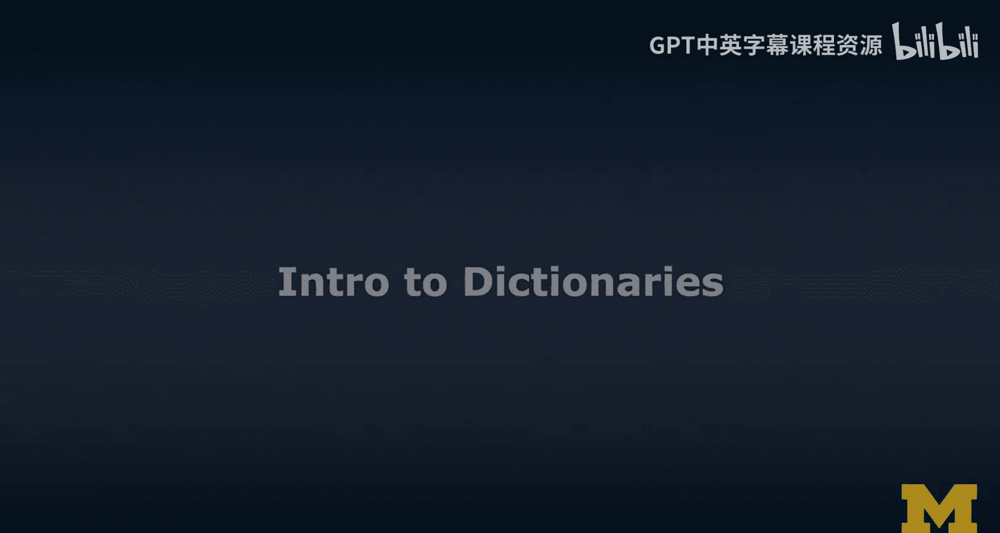
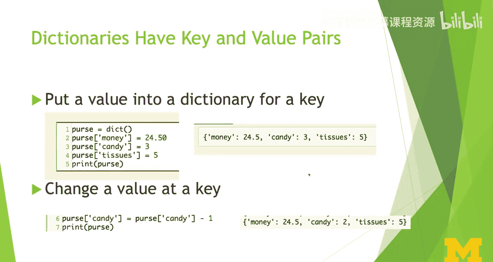
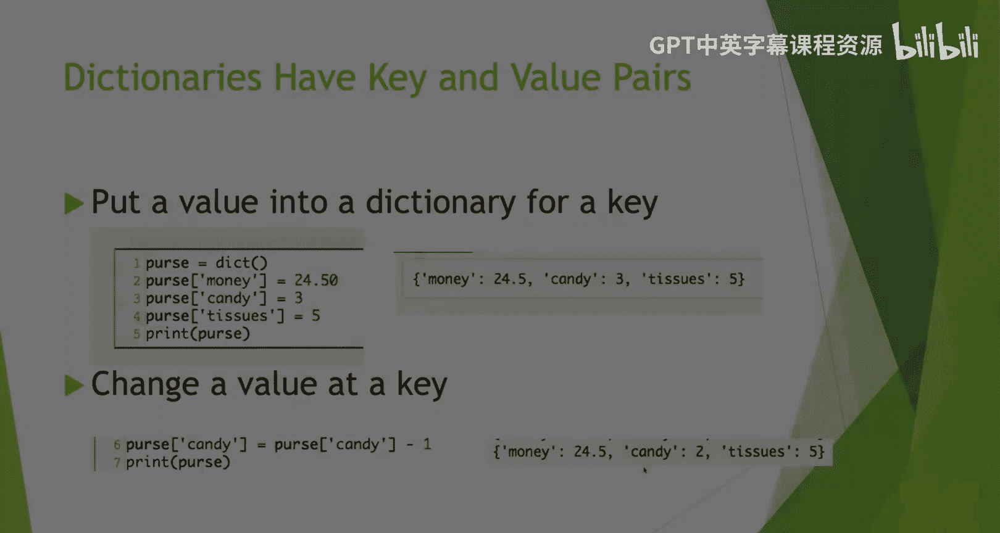
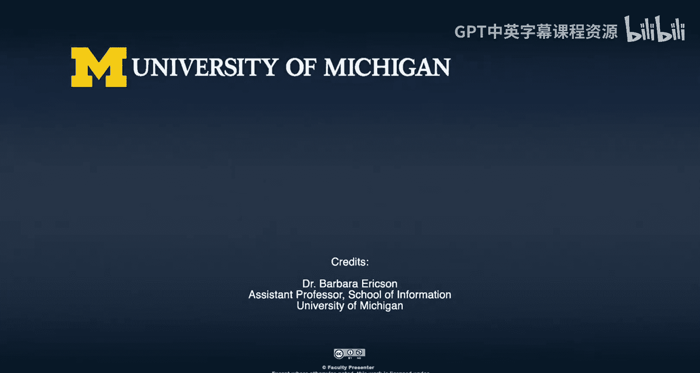

# 密歇根大学《创造性编程（创意、面向对象、debug、QA）｜Creative Coding： Hands-On Python》中英字幕 p42 41_字典基础教程.zh_en -BV1ef421S7Bc_p42-

So we've talked about lists that holds items in orders and are changeable or mutable。

 We've also talked about tuples， which also hold items in orders like lists。

 but are not changeable or not they're called immutable。 You can't change them。

 The other major data structure。 we're going work with is a dictionary。

 And it's quite a different data structure。 So lists are a kind of collection， right。

 lets us have multiple things that we give one name to。 that's one of the handy things about it。

 And it holds those items in order。 dictionaries are also a collection。

 can we can give one name to a large amount of things。 And what it does is hold key in value pairs。

 So given a key， you can put something in sort of like a P box。 and you can take something out。

 given that key， but just one thing， that one thing could also be a collection。

 So dictionaries are the most powerful data collection that we have in Python。

 And they're similar to other things in other languages like a map or hash map or property bag in C sharp。

And then dictionaries have， of course， key in value pairs and those key in value pairs。

 So given a dictionary and I can create a new dictionary saying DicCT and then parentheses。

 that's an empty dictionary， I can set for a key a value。 So for the key money， I can set a value 24。

50 for a key candy， I can set the value 3 key tissues。

 I can set the value to5 and I can print then this purse notice it uses curly braces around a dictionary。

 So lists square brackets， tus don't have to have parentheses， but often shown with parentheses。

 and then dictionaries are the curly brace。 you can also change the value given a key。

 So if I change a key if I have a key I can say purse of candy equals purse a candy minus-1 and that'll update the value at that key。

 So that's a quick intro to dictionaries。

