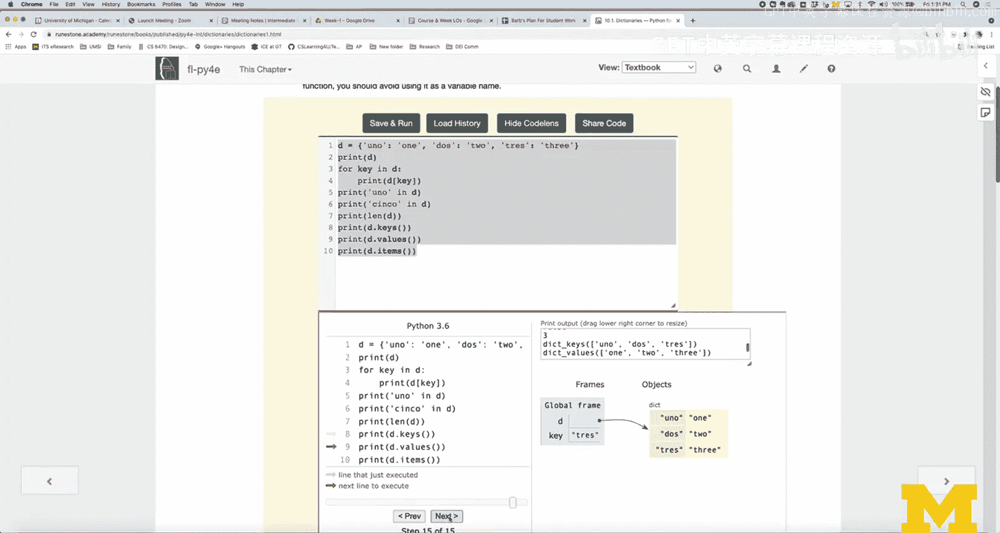

# 密歇根大学《创造性编程（创意、面向对象、debug、QA）｜Creative Coding： Hands-On Python》中英字幕 p43 42_字典进阶操作.zh_en -BV1ef421S7Bc_p43-

So let's talk a little bit more about dictionaries and what you can do with dictionaries。

 One of the things we use dictionaries for often is counting something So for a key particular accountinging how many times a key occurs for a key we keep track of how many times we've seen it Another thing is to map from one thing to another so you can use a dictionary to look up given a Spanish word what's the equivalent English word here's an example of that So we have D equals this dictionary that has keys of the Spanish word and the value is the equivalent English word So for uno those traits one23 and let's walk through this code with the Python visualizer So if we step through this。

We see first the dictionary get created and there's keys mapped to values and then we can print that whole thing notice it comes out with curly braces around it that's how we know it's a dictionary or one indicator it's a dictionary we can loop through each of the keys for key in the dictionary so if we ask to it's a you know type of iterator for a dictionary gives you back a list of the keys so I can loop through the list of the keys so it starts off each key one at a time。

 print the value at that key so we're going to print one then two then three。

Now we'll print is that key U know in the dictionary， so a result of that is true it is。

 how about Sco is that in the dictionary， no， that's false， it's not in the dictionary。

 so you can use in to say iss this key in this dictionary。

And then we can print the length of the dictionary， how many keys are there and value pairs。

 we can print a list of just the keys， notice it's a list， the square brackets。

 we can get a list of just the values， or we can get a tuple which is the keys and value pairs。

 so those are some of the things you can do with dictionaries。

