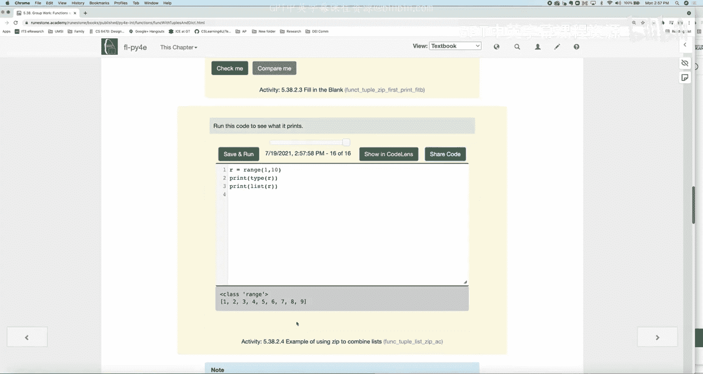

# 密歇根大学《创造性编程（创意、面向对象、debug、QA）｜Creative Coding： Hands-On Python》中英字幕 p44 43_zip函数功能解析.zh_en -BV1ef421S7Bc_p44-

So let's take a closer look at one of the interesting functions that you can use Z。

 What is this doing？So here's an example。 we have two lists， and they each have two items in them。

 and then we create a result by zipping those together。 So think of it as zipping some fabric。

 So you have two pieces of fabric and you're zipping them together。

 And what it's doing here is I have these two list with two items。

 It's going to take those two things。 And instead create a list of tuples where it's going to have this first element in it。

 And then this followed by this element。 So it's zipping these together one at a times。

 So let's take a look at when I run it。And I see that the resulting is a list of tuples。

 and the first element is the first thing from the first list。

 followed by the first thing from the second list。 And then the next element is a tuple with the first。

 the second thing and the first list followed by the second thing and the second list。

 So it's just sort of grabbing these two lists and putting them together into tuples。

 So this is one of the nice utility features for taking two lists and turning them into a list of tuples。

But what actually does this give you， let's take a little closer look。

 So I'm going to print the types。 remember， one of the nice things you can always do in Python is find out。

 print the type of something to see what you're actually getting。So if I print the type of it。

 I see it's class zip。 What does that mean， So class zip is a kind of iterator。

 which is something that returns next， next， next。 so I can use a for each loop to loop through it one at item at a time。

 So that's what we've got。 You've got a class zip that can return things one at a time。

 So if I want to get an actual list from it， I have to convert it using the list function that says okay。

 take this iterator and give me an actual list。 I can do the same thing with a range if you've ever done a range。

 So if I say our equals range from one to 10。And then I say print type of R。Oops。Comment10。

And I get class range and remember that I can loop through。For item in rain in R。

 I know how to loop through these print item。So range and string and list are all things we can iterate through。

 they can all give us back something， but if I actually want a list to see the list。

I would have to say I could do also convert this to a list。

So instead of having to loop through it like that， I could do this and then I get back a list of those items。

