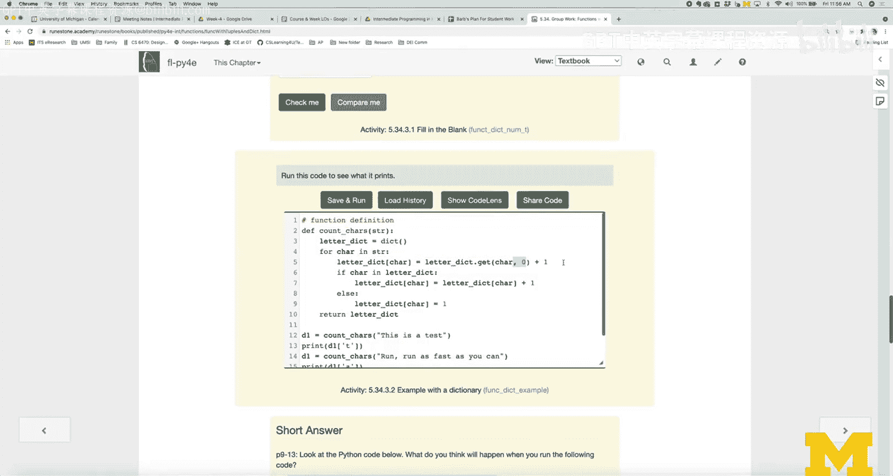

# 密歇根大学《创造性编程（创意、面向对象、debug、QA）｜Creative Coding： Hands-On Python》中英字幕 p45 44_字典计数优化方法.zh_en -BV1ef421S7Bc_p45-

So whenever you're working with dictionaries， one of the things you have to be careful about is you don't want to get a key and a cure happens if you try to access a value at a key and that key is not in the dictionary。

And so let's look at this code。 So we're saying here's a function。 Def count characters in a string。

 Cate a dictionary called letter dictionary。 set it to the empty dictionary。

 looplo through each character in that string。 If the character is in letter dictionary。

 If it's a key that's found in the dictionary。 then set letter dictionary at that key equal to letter dictionary of that key plus one。

 So increment it Otherwise， set letter dictionary for that key equal to one。

 because it's the first time we've seen it。 and then return the dictionary。

 So I want to show you a way that you can do this instead of in these four lines of code in just one line of code and have the same result。

😊，So we can say set letter dictionary of that key equal to letter dictionary。Dot get。And of the key。

 And then what value to use if it's not there。And so what this does is say。

Set letter dictionary of this character equal to check first C if the key is in the dictionary using dot get。

 So check if that key is there。 If it is， get that value， otherwise use 0。

 So it does the same thing as these four lines。 It says if it is in the dictionary than get its current value。

 And we're going to add one to it。 If it's not in the dictionary。

 Then we're going to use 0 as the result from this。 And we'll add one to it。

 which will set it to one， just like we did here in this line。

 So this is a much shorter and better way of handling incrementing of value for a key。

