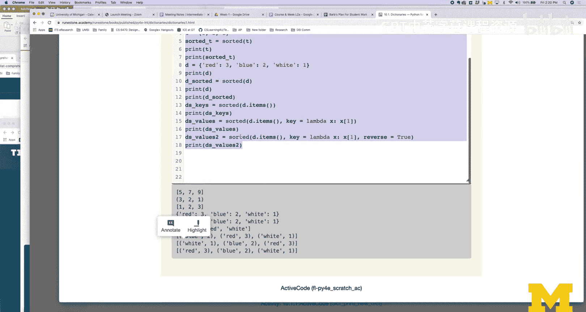

# 密歇根大学《创造性编程（创意、面向对象、debug、QA）｜Creative Coding： Hands-On Python》中英字幕 p46 45_列表-元组-字典排序技巧.zh_en -BV1ef421S7Bc_p46-

One of the things you often want to do with lists or tuples or dictionaries is is them because you might want to say。

 okay， let's try to find something in a list and if it's sorted。

 it's easier to look for things I can use binary search split in half split it in half till I find it with dictionaries I might want to sort if I'm counting how many there are for a particular key。

 I might want to sort the dictionary then by those values to see what was the top 10 items or the bottom 10 items。

 So let's take a closer look at how we can sort and lists tus tuples and dictionaries。

So let's take a look at this code。 We have this list， and I'm going to use the Python tutor。

To step through this code。 So we first create this list。You see the list here。

 we're going to sort it。 What happens is the list itself changes。

So I can't do that with tuples or dictionaries。 I can't just change the list。

 remember tuples are immutable， you can't change them so I can't use dot sort on them so only list can I use dot sort on which actually changes the list。

So I can print the values now I see that they've changed， I can get a tuple here。

 but I can do is use a sorted function on a tuple to return a new list and I'll see what happens as it returns。

 I'll print what that is， I see that it returns a new tuple。Oh， I'm sorry。

 I printed the original tuple。 There's the tuple。 What it does is return a list of values now sorted in acending order。

 So if I use sorted on a tuple， I get back a list， not a tuple and sorted in ascending order。

 What happens if I try this on a dictionary。 So I have a dictionary here。 key in value pairs。

 I print the dictionary。 I see it there。 Now， I say de sorted underscore sorted is sorted of that dictionary and print that。

 And I see， I get have to print de sorted yet。 I see I get a list of the keys that are sorted in ascending order。

 So that may not be really what I was looking for。So another thing I can do remember is get a list of couples of key and value pairs。

 So if I say sorted of that， what happens， what happens when I print that so now I'm getting a sorted list of key and value pairs。

 again， those sorting on the key， which may may not be what I want what I probably want is to sort on the value。

 So how can I sort on the values。So one of the ways I can do that is。Using a key equal lambda。

 So I'm sort of creating an anonymous function of x that given an x returns x of 1。

 So for every tuple in this list of tuples， given the tuple has x。

 I'm going to return the the item at index 1。 So the second thing， which is the value。

And if I do that， I see that what I get is a sorted。

List of temples where I'm sorting in ascending order the values。 So not by keys anymore。

 I'm sorting by values。 And then if I want to reverse that。

 I can just include this reverse equal true as another comma。Parameter to the sorted function。

 and then I will get it in reverse order， so the highest value first。

So remember， I can use sort on list， but it modifies a list。

 I can use the sorted function on tuples and dictionaries， but I have to use this anonymous。

Function using the lambda in order get to sort a dictionary on the values。

