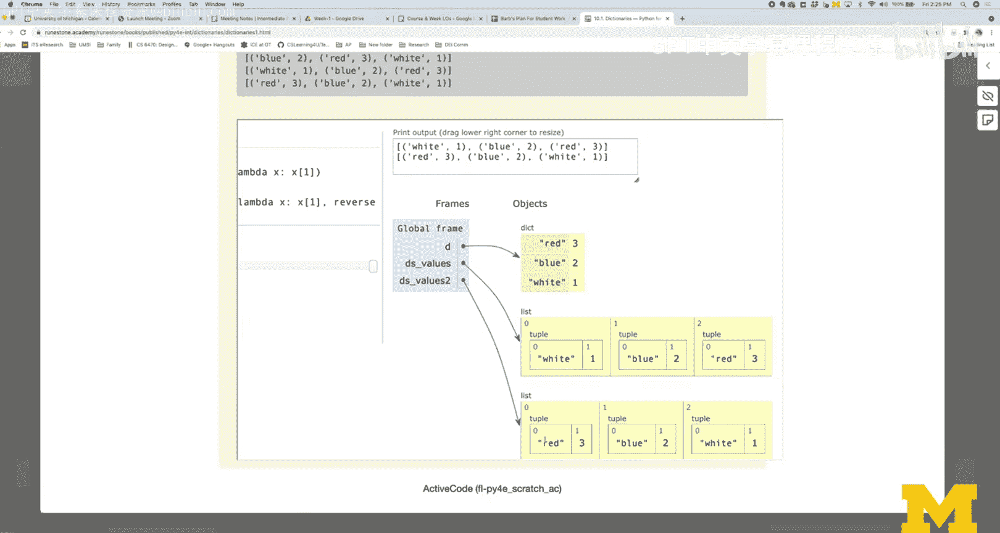

# 密歇根大学《创造性编程（创意、面向对象、debug、QA）｜Creative Coding： Hands-On Python》中英字幕 p47 46_使用lambda排序.zh_en -BV1ef421S7Bc_p47-

Let's take a closer look at what's happening when we use the sorted function with an anonymous function。

With this key equals lambmbda， so we create our dictionary。

And we can see there we have key in value pairs。 and then we say Ds equals sorted of d of items key equals lambda x and then x of1。

 What we're saying is create this temporary function。 And this is the lambda symbol。

 So x is this temporary function that gets this tuple I mean sorry we have this anonymous function that gets passed in each tuple one at a time。

 So the first tuple is read with three。 And if we get index one of that。

 we're going to return value 3。And now we get past in index the tuple with blue and two。

 and so that's going to now return。The item at index 1。

 which is 2 and the same thing for the next piece。 So we get white， and we return one。

 And what that does then is then sort by those values。 So we see this ascending sort by these values。

1，2，3。 So the keys are there。 So we're sorting that list of tuples。Same thing。

 but when we do reverse。We're going to prioritize by the highest value。

Here we're going to do the same thing we're looping through red green blue。

 we see that we get a return value of three for the first one for the second we'll get a return value of two。

 third one， get return value of one， and now it's created a new list of tuples that is sorted by in descending order。

