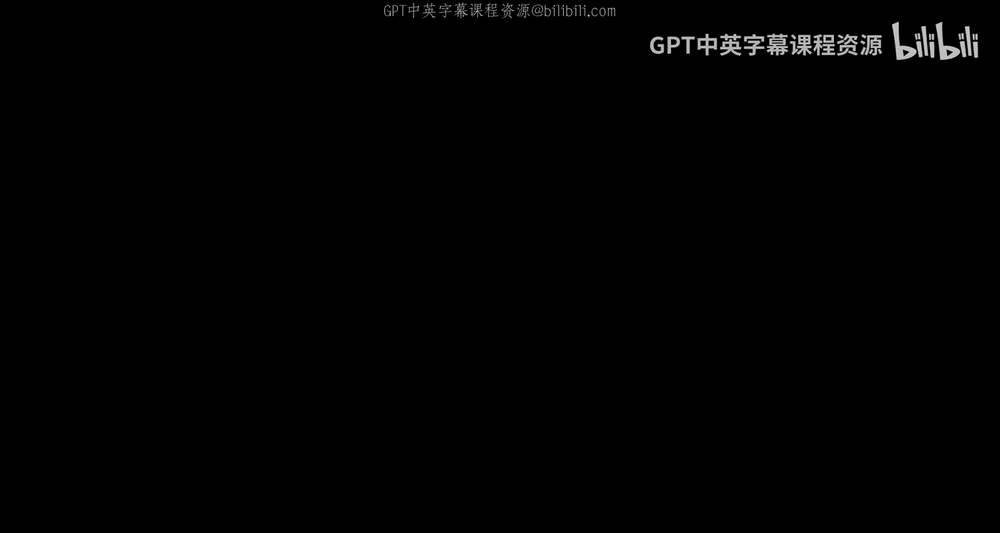
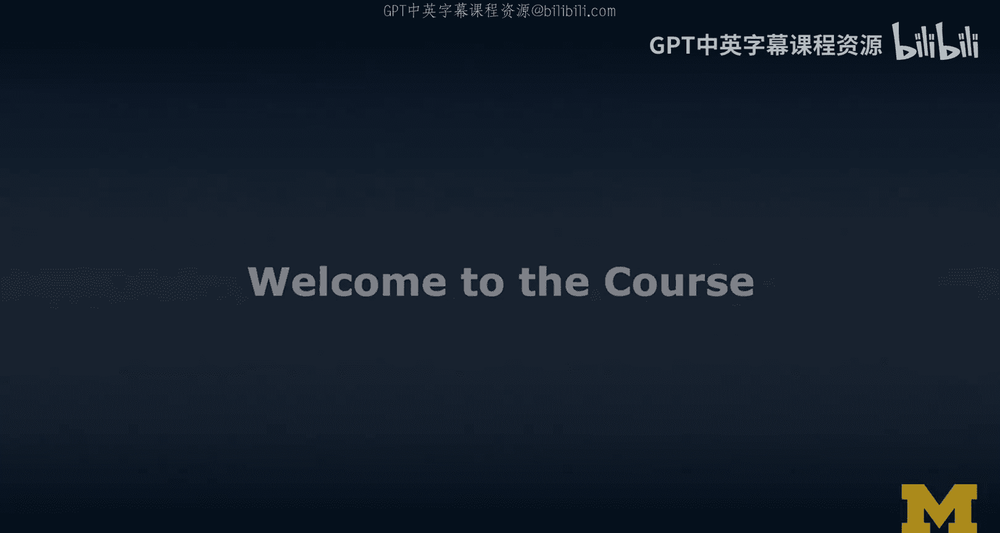
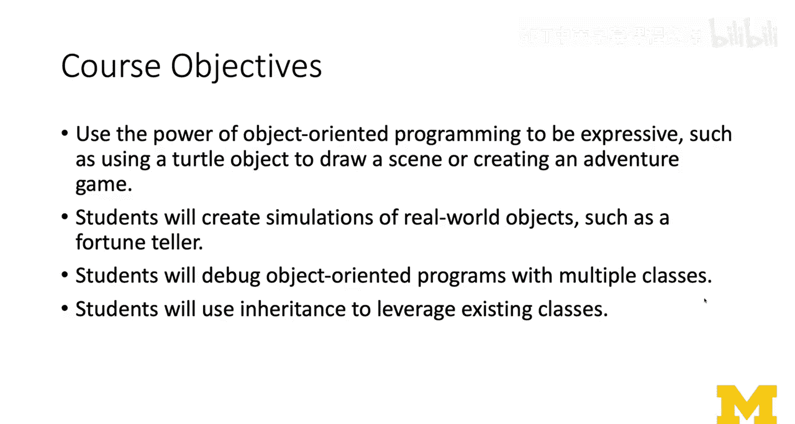
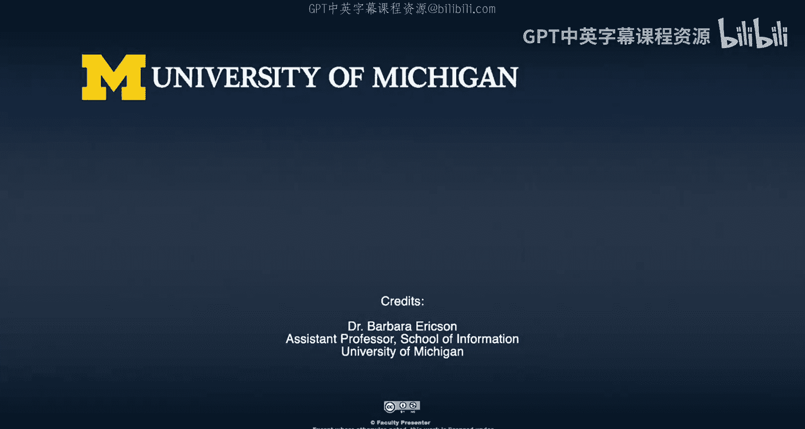
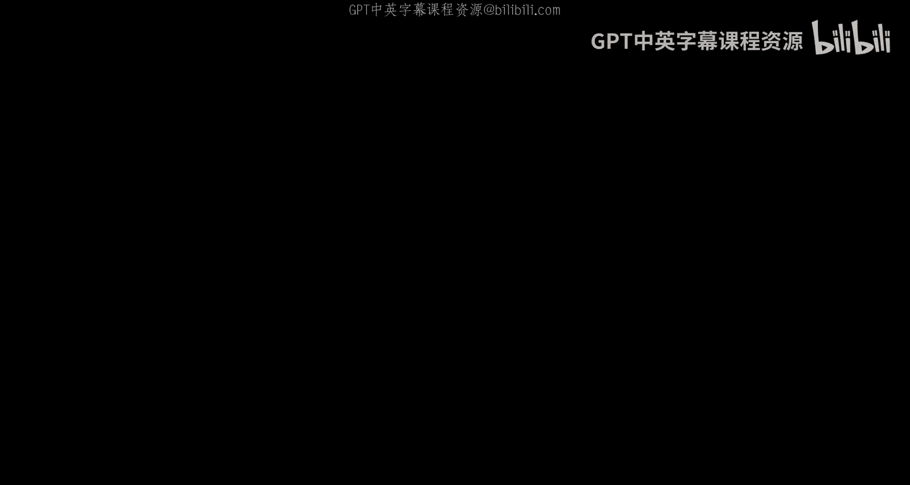

# 密歇根大学《创造性编程（创意、面向对象、debug、QA）｜Creative Coding： Hands-On Python》中英字幕 p48 0_遇见Barb Ericson博士.zh_en -BV1ef421S7Bc_p48-

Welcome to this course in this course， you're going to use the power of objectord programming。

 that's one of the big changes since I first got into programming or computing is the prevalence now of object orated programming。

 So it's very important for you to understand what's an object， What's a class。

 how do you write code using objects in classes。 How can you use objects that are already defined。

 So that's what we're going to focus on in this course。

 So you're going to use the power of object or programming to be expressive。

 such as using a turtle object like a little robot turtle with a pen in it to draw a scene or creating an adventure game。

Students will create simulations of real world objects such as a fortune teller that's one of the powers of object current program is you can simulate real world objects。

Students will debug object programs with multiple classes。

 Most real programs will have multiple classes in them。

 Students will use inheritance to leverage existing classes。

 So inheritance lets you build off of existing things。 So I hope you have a great time。😊。

